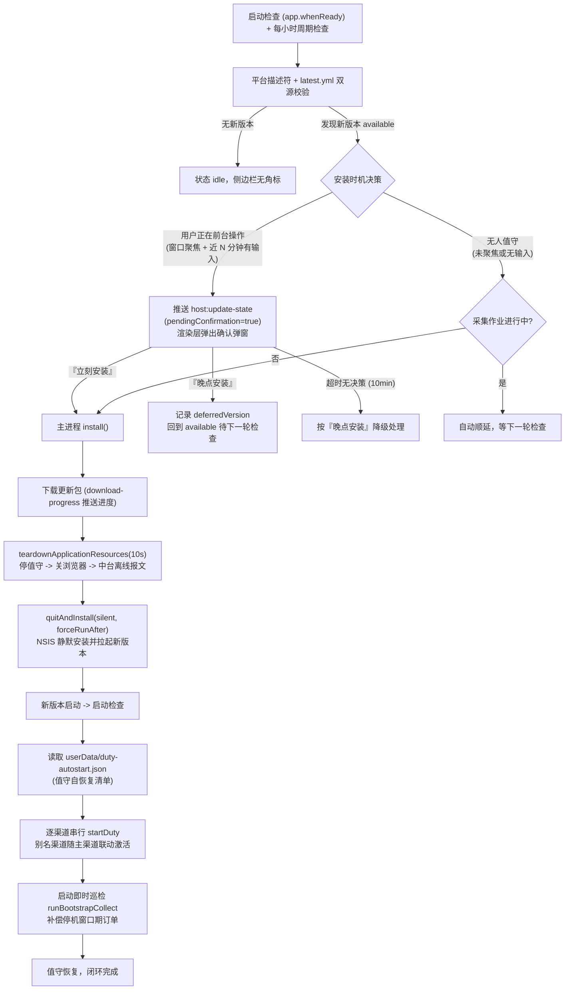

# 桌面端自动更新与值守自恢复设计 (Auto Update & Duty Resume)

> 文档状态：P1、P2 已实施；P3 待实施
> 适用模块：`electron/desktopUpdateService.ts`, `electron/main.ts`, `electron/preload.ts`, `src/crawler/duty/dutyOrchestrationEngine.ts`, `src/crawler/duty/dutyAutostartStore.ts`, `src/hooks/useAppUpdate.ts`, `src/components/update/UpdateConfirmModal.tsx`, `src/components/sidebar/Sidebar.tsx`
> 关联文档：`electron-runtime-architecture.md`、`order-guardian-design.md`

---

## 1. 背景与目标

Smart-Link 工位的核心价值是**无人值守的渠道订单自动化**。当前应用内更新链路（探测 → 下载 → 停值守 → 静默安装 → 重启）已具备完整能力，但存在两个断点：

1. **安装只能手动触发**：`install()` 依赖用户在侧边栏点击按钮（`src/hooks/useAppUpdate.ts` → IPC `app-update:install`），无人值守场景下新版本永远不会被安装。
2. **值守状态不持久**：值守渠道运行态是纯内存的（`DutyOrchestrationEngine.channelStates`，`dutyOrchestrationEngine.ts:124`），更新重启后所有渠道回到 STOPPED，必须人工逐个重新开启，中台侧工位也经历一次离线盲区。

**目标**：实现「探测到新版本 → 智能决策安装时机 → 自动静默安装 → 重启后自动恢复值守」的完整闭环，全程无需人工介入；当用户正在前台操作时，通过弹窗将决策权交还给用户。

## 2. 总体流程



## 3. 更新触发策略：前台检测与弹窗决策（P2 已实施）

> 本节为方案核心增量：静默安装触发时，若用户正在前台操作，弹窗交由用户决策；否则保持全自动。
>
> 实施落位（2026-11-18）：
> - 决策核心：`DesktopUpdateService.evaluateAutoInstall()`（`runCheck` 确认 available 后调用；注意 electron-updater 的 `update-available` 事件先于 `checkForUpdates()` resolve 到达，决策入口必须置于状态兜底 if 之外）
> - 服务新选项：`autoInstallEnabled` / `isUserPresent` / `hasActiveCollectionJobs`；新公开方法 `confirmInstall()` / `deferInstall()`；常量 `UPDATE_CONFIRM_TIMEOUT_MS`（10min）、main 侧 `USER_ACTIVE_WINDOW_MS`（5min）
> - 互斥保持：`evaluateAutoInstall` 直接静默安装时会接管 `this.operation`，`check()` 的 finally 以「仍指向本次检查对象」为条件清理，避免误清安装互斥
> - 前台判定：`main.ts` `isUserPresentForUpdate()`（`mainWindow.isFocused()` + 渲染层经 `host:user-input-heartbeat` IPC 上报的输入时间戳，30s 节流，5min 窗口）
> - 渲染层：`UpdateConfirmModal`（`src/components/update/`，复用 Modal，`closeOnBackdrop=false`，倒计时基于 `confirmDeadlineAt`）；`useAppUpdate` 暴露 `confirmInstall`/`deferInstall`；`useUserInputHeartbeat` 挂于 App 根组件（登录门禁内外均生效）
> - 测试：`desktopUpdateService.test.ts` 决策矩阵 8 例（含 fake timer 超时降级）、`UpdateConfirmModal.test.tsx` 5 例、`preload.test.ts` 桥接 1 例

### 3.1 决策矩阵

| 场景 | 判定条件 | 行为 |
| --- | --- | --- |
| 用户正在操作 | 主窗口 `isFocused()` **且** 渲染层近 `USER_ACTIVE_WINDOW_MS`（默认 5 分钟）内有鼠标/键盘输入 | 弹窗决策：立刻安装 / 晚点安装 |
| 弹窗超时未决策 | 弹窗挂起超过 `CONFIRM_TIMEOUT_MS`（默认 10 分钟） | 按「晚点安装」降级（保守，不打断疑似离开的用户） |
| 无人值守 | 窗口未聚焦，或超过 5 分钟无用户输入 | 直接静默安装（跳过弹窗） |
| 采集作业进行中 | `hotelCollectionEngine` 存在活跃作业（`src/crawler/engine.ts:19`） | 自动顺延至下一轮检查；若用户主动点「立刻安装」，弹窗内明示将中断采集 |

设计要点：

- **弹窗只服务于「保护用户当前工作会话」**。无人值守（聚焦丢失 / 无输入，含 Windows 锁屏场景——锁屏下不会有输入事件）恰恰是静默安装的目标场景，不应被弹窗阻塞，否则 7×24 工位永远等不到人工确认，更新永远装不上。
- **「晚点安装」语义 = 本轮放弃，下一轮周期检查（1 小时后）重新走决策流程**。不做复杂的退避调度，靠天然的小时级节奏控制打扰频率。
- 锁屏误判兜底：`isFocused()` 在锁屏时可能仍返回 true，因此前台判定必须叠加渲染层输入活跃度（`mousedown/keydown/wheel` 任一事件刷新时间戳），双条件同时满足才算「用户在场」。

### 3.2 弹窗交互规范

复用现有 `src/components/common/Modal.tsx` 与 Geist 设计令牌，弹窗形态：

- **标题**：`发现新版本 {targetVersion}`
- **正文**：`新版本已就绪。安装需要停止值守任务并重启应用（约 1 分钟），值守将在重启后自动恢复。`
- **风险提示行**（仅当采集进行中）：`当前有渠道采集作业进行中，安装将中断该作业。`
- **主按钮**：`立即安装更新`（primary，触发 `app-update:confirm-install`）
- **次按钮**：`晚点安装`（secondary，触发 `app-update:defer-install`）
- **倒计时提示**：按钮区上方展示 `如无操作，将于 {mm:ss} 后自动顺延`（label-13，gray-900）
- 弹窗期间侧边栏保留现有 `available` 角标（`Sidebar.tsx`），双通道提醒

## 4. 主进程改动：DesktopUpdateService 扩展

### 4.1 状态机扩展

`src/types/update.ts` 的 `AppUpdateState` 增加确认态字段（不新增 status 枚举值，`available` 复用）：

```ts
export interface AppUpdateState {
  // ...现有字段
  pendingConfirmation: boolean; // true 时渲染层弹确认弹窗
  confirmDeadlineAt: number | null; // 弹窗决策截止时间戳
}
```

### 4.2 DesktopUpdateService 新增决策入口

`electron/desktopUpdateService.ts`：

```ts
// 新增选项
export interface DesktopUpdateServiceOptions {
  // ...现有字段
  autoInstallEnabled: boolean;          // 总开关（平台下发或本地配置）
  isUserPresent: () => boolean;         // 前台判定（main.ts 组装：isFocused + 输入活跃度）
  hasActiveCollectionJobs: () => boolean; // 采集互斥检查
}
```

- `runCheck()` 确认 `available` 后不再直接返回，进入 `evaluateAutoInstall()`：
  - `!autoInstallEnabled` → 维持现状（手动模式，仅角标提醒）
  - `isUserPresent()` → 置 `pendingConfirmation=true` + `confirmDeadlineAt`，推送状态，挂起 `Promise` 等待 IPC 决策或超时
  - 无人值守且无采集作业 → 直接 `void this.install()`
  - 无人值守但有采集作业 → 记日志顺延
- 新增公开方法 `confirmInstall()` / `deferInstall()`，由 IPC 调用，resolve 挂起的 Promise：
  - `confirmInstall()` → 清确认态，走现有 `install()` 链路（下载 → teardown → `quitAndInstall(true, true)`，`desktopUpdateService.ts:362` 不变）
  - `deferInstall()` → 清确认态，回 `available`，记录 `deferredVersion`（同一轮内不再重复弹）
- 超时降级由挂起 Promise 的 `setTimeout` 实现，等价于 `deferInstall()`
- 失败退避：`install` 失败进现有 `error` 态后不自动重试，等下一轮周期检查自然重置；小时级节奏天然防循环

### 4.3 IPC 与桥接扩展

`electron/main.ts` `registerDesktopUpdateIpcHandlers`（`main.ts:393`）新增：

```ts
ipcMain.handle('app-update:confirm-install', () => service.confirmInstall());
ipcMain.handle('app-update:defer-install', () => service.deferInstall());
```

`electron/preload.ts` `updateApi` 同步暴露 `confirmInstall` / `deferInstall`，`src/types/host.ts` 更新 `AppUpdateBridgeApi`。

### 4.4 前台判定实现（main.ts）

```ts
let lastUserInputAt = 0;
// 渲染层经 IPC 上报输入活跃度（节流 30s 上报一次即可，仅刷新时间戳）
ipcMain.on('host:user-input-heartbeat', () => { lastUserInputAt = Date.now(); });

function isUserPresent(): boolean {
  const focused = mainWindow ? mainWindow.isFocused() : false;
  const recentlyActive = Date.now() - lastUserInputAt < USER_ACTIVE_WINDOW_MS;
  return focused && recentlyActive;
}
```

渲染层在 `App` 根组件挂一次性事件监听（`mousedown` / `keydown` / `wheel`），节流调用 `window.host.reportUserInput()`。

## 5. 渲染层改动

| 文件 | 改动 |
| --- | --- |
| `src/store/slices/appSlice.ts` | `setUpdateState` 已透传新字段，无需结构改动 |
| `src/components/update/UpdateConfirmModal.tsx`（新增） | 读取 `update.pendingConfirmation` 渲染弹窗；倒计时基于 `confirmDeadlineAt`；`closeOnBackdrop=false`（防误关，超时自动顺延兜底） |
| `src/hooks/useAppUpdate.ts` | 暴露 `confirmInstall()` / `deferInstall()` 回调 |
| `App` 根组件 | 挂载 `UpdateConfirmModal` 与用户输入心跳上报 |

下载/安装进度沿用现有 `downloading` / `installing` 状态与侧边栏进度条，弹窗确认后UI与手动安装完全一致。

## 6. 值守自恢复：持久化与启动恢复（P1 已实施）

> 实施落位（2026-11-18）：
> - 清单存取：`src/crawler/duty/dutyAutostartStore.ts`（`loadDutyAutostart` / `saveDutyAutostart` / `parseDutyAutostartSnapshot`，文件 `${userData}/duty-autostart.json`，0o600）
> - 引擎接口：`DutyOrchestrationEngine.persistDutyAutostart()`（仅落盘主渠道，过滤别名）与 `resumeDutyFromAutostart()`（读清单 → 先还原商旅分流开关 → 串行 `startDuty` → 按实际结果刷新清单，失败渠道显式 WARN 后跳过）
> - main.ts 接线：`duty:start` / `duty:stop` / `duty:stop-all` 成功分支调用 `persistDutyAutostart()`；`app.whenReady()` 在 `createMainWindow()` 之后 `void resumeDutyFromAutostart()`（不阻塞窗口创建）
> - 单元测试：`tests/crawler/duty/dutyAutostartStore.test.ts`（14 例）+ `dutyOrchestrationEngine.test.ts` 值守自恢复块（5 例）+ `tests/electron/main.test.ts` IPC 刷新清单用例（3 例）

### 6.1 运行态持久化

**文件**：`${app.getPath('userData')}/duty-autostart.json`

```json
{ "version": 1, "channels": ["MEITUAN", "DOUYIN"], "savedAt": 1737000000000 }
```

**写入时机**（`electron/main.ts` 对应 IPC handler 成功分支内，约 5 行/处）：

- `duty:start` 成功 → 写入
- `duty:stop` / `duty:stop-all` 成功 → 写入（停止后即当前活跃快照，可能为空数组）
- `teardownApplicationResources()` 内 `stopAllDuty` 之后不写——更新安装的快照在最后一次用户操作时已落盘，重启后照常恢复

**写入内容过滤**（关键）：

- 仅持久化**主渠道**。`getActiveChannelCodes()`（`dutyOrchestrationEngine.ts:360`）含别名渠道（如 MEITUANBIZ），别名是主渠道 + 商旅分流开关联动的派生态（`linkAliasChannelsForPrimary`，`dutyOrchestrationEngine.ts:375`），恢复时由 `startDuty(主渠道)` 自动重建——持久化别名会导致重复启动报错（别名无独立启动入口，`dutyOrchestrationEngine.ts:456-461`）
- 过滤规则：`codes.filter(code => runners.has(code) && !aliasToPrimary.has(code))`

### 6.2 启动自恢复

`app.whenReady()`（`main.ts:1109` 附近，`createMainWindow()` 之后）：

```ts
async function resumeDutyFromPersistedState() {
  const codes = await readDutyAutostart(); // 读文件 + 过滤 + 容错（文件缺失/损坏返回空）
  for (const code of codes) {
    try {
      await dutyOrchestrationEngine.startDuty(code); // 串行！共享浏览器会话不能并发唤起
    } catch (err) {
      logger.warn('[值守恢复] 渠道自动恢复失败，跳过', { module: 'DUTY_TASK', details: String(err) });
    }
  }
}
// 不阻塞窗口创建：void resumeDutyFromPersistedState();
```

依赖的既有能力（均无需改动）：

- `startDuty` 幂等（已运行直接返回成功）与僵尸态自愈（`dutyOrchestrationEngine.ts:469-477`）
- 启动即时巡检 `runBootstrapCollect`（`dutyOrchestrationEngine.ts:535`）自动补扫停机窗口期订单并创建入单任务——**值守中断期间订单不丢**
- 文旅平台 Token 有 `initNodePlatformTokens()` 恢复；未完成授权时 `startDuty` 走中台自愈降级（`dutyOrchestrationEngine.ts:518-529`），不阻塞恢复流程
- 浏览器登录态走 persistent profile，重启后免扫码

## 7. 边界与降级场景

| 场景 | 处理 |
| --- | --- |
| 弹窗挂起期间用户直接关窗/退出应用 | `before-quit` 既有 teardown 链路照常执行；确认态随进程消亡，下次启动检查重新决策 |
| 下载失败 / teardown 超时（10s） | 进 `error` 态 + 侧边栏 toast（现有 `useAppUpdate` 错误 toast 复用）；值守未被波及（teardown 失败时 `quitAndInstall` 不会执行），下一轮检查重试 |
| `quitAndInstall` 后 NSIS 安装失败 | 超出应用控制范围；旧版本已退出，依赖 NSIS one-click 原子性。日志上传链路（`logUploadScheduler`）已在上传会话级日志辅助排障 |
| 值守恢复时渠道已不支持 | `startDuty` 抛「暂不支持渠道」，捕获跳过并告警，不阻断其他渠道 |
| 恢复时用户恰好在操作 | 串行唤起前台浏览器窗口会抢占焦点——属预期行为（值守优先），日志明示 `[值守恢复]` 前缀 |
| 多渠道恢复中途失败 | try/catch per channel，失败渠道记入恢复报告日志，成功渠道不受影响 |
| `autoInstallEnabled` 关闭 | 退化为现状：仅角标 + 手动安装，弹窗逻辑整体旁路 |

## 8. 常量与配置

| 常量 | 默认值 | 说明 |
| --- | --- | --- |
| `USER_ACTIVE_WINDOW_MS` | 5 min | 输入活跃判定窗口 |
| `CONFIRM_TIMEOUT_MS` | 10 min | 弹窗无决策自动顺延 |
| `DESKTOP_UPDATE_CHECK_INTERVAL_MS` | 1 h（现有） | 周期检查节奏，兼作「晚点安装」的重试节奏 |
| `autoInstallEnabled` | `true`（打包版） | 总开关；开发态因 `canUpdate=false` 天然旁路 |
| `DUTY_AUTOSTART_FILENAME` | `duty-autostart.json` | 值守自恢复清单 |

## 9. 测试要点

单测（沿用 `tests/electron/desktopUpdateService.test.ts` 的 fake updater/scheduler 模式）：

1. **决策矩阵**：前台 + 输入活跃 → 置 `pendingConfirmation`；未聚焦 / 无输入 → 直接触发 `install()`；采集进行中 → 顺延不安装
2. **确认流**：`confirmInstall` 走完整下载→teardown→quitAndInstall 链路；`deferInstall` 回 `available` 且同轮不重弹；超时等价 defer
3. **自恢复**：autostart 文件写入过滤别名渠道；损坏文件容错；串行恢复顺序；单渠道失败不阻断
4. **幂等与竞态**：恢复期间触发周期检查不重复安装（复用现有 `operation` 互斥）；`startDuty` 对已恢复渠道幂等

手工验收：打包版 Windows 全链路演练——开双渠道值守 → 触发更新 → 观察弹窗决策/无人值守静默两条路径 → 重启后渠道状态、中台工位上报、停机窗口订单补偿三查。

## 10. 分期落地建议

| 期 | 内容 | 量级 |
| --- | --- | --- |
| P1 | 值守自恢复（持久化 + 启动恢复） | 最小、零风险、独立收益（手动更新重启也受益） |
| P2 | 自动安装 + 前台检测 + 确认弹窗 | 本次方案主体，依赖 P1 才有完整闭环 |
| P3 | 平台侧下发 `autoInstallEnabled` 策略、指定时段静默安装（如凌晨 3-5 点） | 可选增强 |

P1 建议先行：即使自动安装暂不上线，「手动更新重启后值守自动恢复」本身就能消除每次发版后的人工恢复成本。
