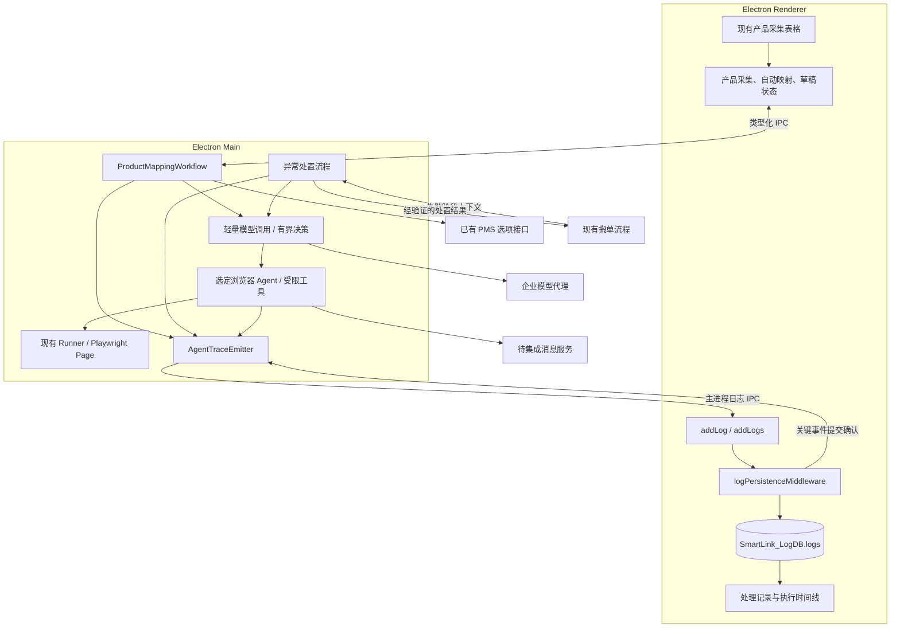
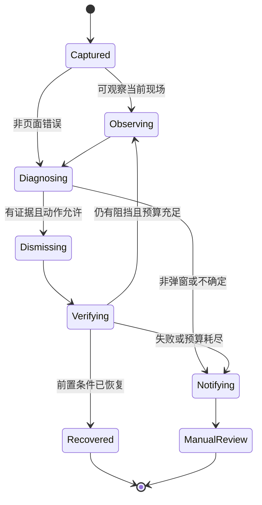

# LLM Agent 产品采集映射、异常处置与执行追踪设计

> 状态：设计提案，待评审；本文不代表功能已经实现。
>
> 日期：2026-10-15
>
> 依据：本次需求、当前工作区源码、项目 AGENTS.md、厂商官方资料。
>
> 范围：Electron 桌面端。现有产品采集流程自动完成三项映射；搬单异常时按需诊断、关闭阻挡弹窗或推送消息；全过程可追踪。

阅读导航：

- [设计结论](#2-设计结论)与[技术选型](#4-技术选型与取舍)。
- [产品采集自动映射](#6-产品采集与自动映射流程)与[异常诊断和弹窗处置](#7-异常诊断与弹窗处置)。
- [执行追踪](#9-执行追踪设计)、[工程落点](#11-工程落点与接口草案)和[分阶段交付](#14-分阶段交付)。
- [实施前待确认项](#162-实施前需用实际业务和接口确定)与[官方资料](#17-资料与证据)。

## 1. 需求与业务入口

### 1.1 产品采集后的自动映射

**接入位置是现有“产品采集”流程。采集到 OTA 房型产品后，Agent 使用 PMS 获取的房型、房价码、预订类型选项，自动填入当前产品表格中原来由人工逐项选择的三项映射，并为每条结果评级。**

这是一项集成到原流程的自动化能力，不另建一个要求客户逐条提问的聊天工作台。

| 环节 | 当前行为 | 目标行为 |
| --- | --- | --- |
| 选择渠道和酒店 | 人工选择已映射的渠道、酒店 | 沿用 |
| 采集 OTA 产品 | 抓取 OTA 产品及物理房型，合并历史映射 | 沿用，并保留用于匹配的必要原始属性 |
| 获取 PMS 选项 | 查询房型、房价码、预订类型 | 作为本次自动映射的真实候选集 |
| 填写三项映射 | 客户逐行选择三个下拉框 | Agent 自动填写能够确定的项，标记置信度与待核对原因 |
| 核对与修改 | 客户逐条查找、比对、选择 | 客户集中检查不确定结果，也可以修改任意结果 |
| 保存 | 单行或批量保存 | 首期沿用保存动作；自动映射与自动提交保存分别控制 |

产品例子仅用于解释输出形态，不代表当前接口已有这些属性：

```text
OTA 产品：豪华大床房·双早·提前订
OTA 物理房型：豪华大床房

自动填写：
  PMS 房型：DLX_K / 豪华大床房
  PMS 房价码：ADV_BF2 / 提前预订含双早
  PMS 预订类型：OTA / 渠道预订

整条评级：高
依据：物理房型一致；早餐和提前订条件一致；
      酒店已有经过确认的该渠道预订类型规则。
```

如果只能确定房型，而无法确定房价码或预订类型，自动填入已确定部分，明确标记“部分匹配，需核对”；不能随意选一个值凑齐三项。

### 1.2 搬单异常后的 Agent 介入

业务链路出现异常后，由 Agent 分析异常信息与可获取的当前页面现场：

1. 如果是可关闭的非业务弹窗阻挡操作，调用浏览器能力关闭弹窗。
2. 验证弹窗消失与原操作的页面前置条件恢复，再由原有业务流程继续。
3. 如果是其他原因，生成可读的异常说明，调用消息推送能力通知指定人员。
4. 判断不确定、关闭失败或继续执行条件不满足，同样通知人工。

不要求事先枚举全部弹窗；通过通用页面观察、语义判断与受限操作处理未知弹窗。正常搬单路径仍由现有代码负责。

### 1.3 执行链路必须可追踪

应能回答以下问题：

- 哪个用户操作或搬单异常触发了 Agent？对应哪个酒店、产品、订单、任务？
- 输入来自哪一批 OTA 产品、哪一版 PMS 选项、哪次页面观察？
- 调用了什么模型、用了哪个提示词版本、发生了几轮调用？
- 模型给出了什么结构化判断？依据是什么？有哪些不确定性？
- 申请调用了什么工具？系统是否允许？实际执行了什么？
- 工具执行后看到了什么？原搬单任务是否真的恢复？
- 消息是否被服务端接收、是否送达？耗时、Token 和成本如何？
- 如果中途断开或崩溃，最后一个确定完成的步骤是什么？

这里的“追踪”指可审计的输入、输出、决策摘要、动作和验证证据。**不依赖获取或保存模型隐藏的内部思维链，也不把模型的解释当成执行事实。**

## 2. 设计结论

综合 Page Agent 和 Browser Use 两个浏览器候选，推荐架构：

> **TypeScript 业务流程 + 轻量模型客户端 + 受限浏览器 Agent（Page Agent / Browser Use 对比验证后选定）+ 现有 Playwright + 业务追踪。**

具体分工：

- 产品映射直接调用模型的结构化输出能力，配合运行时 schema 校验；无需通用 Agent 框架。
- 异常诊断优先使用一次结构化模型调用；需要页面操作时，才进入有上限的浏览器子任务。
- 浏览器子任务将 Page Agent 与 Browser Use 纳入同一轮对比：Page Agent 重点验证 DOM 弹窗和 TS 集成；Browser Use 重点验证复杂 frame、截图辅助判断和当前会话接管。最终选择依真实样本与交付成本确定，详见 4.6、4.7。
- 项目代码拥有酒店范围、字段约束、页面所有权、写操作权限、任务继续条件、通知幂等和追踪持久化。
- 两类任务共享模型请求配置和追踪规范，但拥有不同提示词、输出契约与工具权限。
- 首期不引入多 Agent 委派、长期记忆、向量数据库或新的工作流数据库。
- 框架的 history 或云端 Trace 不作为本系统追踪数据源。唯一持久化源仍是渲染进程 `SmartLink_LogDB`。

**选型方向：首期不把 Vercel AI SDK 作为必选依赖；直接模型调用处理数据任务，浏览器框架处理有限网页子任务，业务流程采用普通 TypeScript。Page Agent 和 Browser Use 都是正式候选，均未通过本项目真实 OTA 验证。**

AI SDK 保留为备选：如果后续确实需要多 provider、流式处理或通用工具循环，再评估引入。版本方面，当前 Electron 33.4.11 内置 Node 属于 20 系列；调研时 `ai` 7.0.141 要求 Node >=22，6.0.307 声明 Node >=18，不能直接安装 `latest`，也不能混用主版本示例。任何候选仍需 Electron 打包实测。[S1][S2][S8]

## 3. 当前代码事实与接入条件

以下为本次检查到的现状，而非未来能力。

| 现有位置 | 已有能力 | 设计影响 |
| --- | --- | --- |
| `src/components/products/ProductSyncView.tsx` | “采集 OTA 产品”、三个下拉框、行编辑草稿、单行/批量保存 | 自动映射直接落到这个操作路径和表格 |
| `src/store/slices/productSlice.ts` | 产品与历史映射合并、PMS 三类选项、采集和保存 thunk | 新增采集到映射的协调流程与明确状态，不在组件内编排模型调用 |
| `src/services/productApi.ts` | PMS 三类选项查询、批量保存映射 | 复用已有真实接口；目前归一化选项主要只有名称和编码 |
| `src/crawler/types.ts` | OTA 产品名、物理房型、产品编码、部分渠道原始数据 | 不应假定已经取得床宽、早餐数、适用日期等全部信息 |
| `src/crawler/duty/dutyTaskDispatcher.ts` | 详情采集、协议解析、中台导入、确认号回填、取消确认 | 需要按实际失败阶段接入诊断，不能统一重跑整项搬单任务 |
| `src/crawler/duty/dutyContracts.ts` | Runner 生命周期、`runWithMutex`、活动 Page、结构化错误 | 页面观察/处置必须经过同一页面所有权和互斥机制 |
| 两渠道的 `*ModalGuard.ts`、`*RiskGuard.ts` | 已知弹窗处理和风控检测 | 保留稳定逻辑；未知异常由 Agent 接入，风控规则仍有否决权 |
| `src/crawler/duty/dutyOrchestrationEngine.ts` | 任务认领、执行、下游派发与回执 | Agent 介入必须发生在最终回执前，保持单次回执与原线缆契约 |
| `src/crawler/duty/dutyTaskLogger.ts` | taskId、渠道、订单号、阶段日志 | Agent 事件沿用任务关联上下文 |
| `electron/main.ts`、`electron/preload.ts`、`src/types/host.ts` | Electron IPC、主进程日志推送 | 新增窄接口，模型与密钥不进入 Renderer |
| `src/store/logPersistenceMiddleware.ts` | Redux 日志唯一落库入口 | 所有 Agent 事件经此路径落库 |
| `src/services/logger.ts`、`src/services/logStorage.ts` | 批量异步落库、幂等 ID、游标查询、7 天清理 | 需要增加可确认的关键事件持久化及 Trace 查询能力 |

### 3.1 必须承认的数据缺口

1. PMS 房型选项目前归一化为 `code/name`，房价码为 `rateCode/rateName`，预订类型为 `code/label`。即使上游返回额外属性，当前函数也不保留这些属性。
2. 产品采集结果合并到 `ProductMapping` 时没有保留通用 `raw`。需要在采集结果仍完整时构建有来源的匹配输入，不能事后从显示名称还原事实。
3. `loadProductMappingsAndOptions` 允许字典请求失败后返回空数组，人工模式可继续展示；Agent 必须区分“请求失败”“权威空列表”“完整非空列表”。
4. 现有 `completed` 可能由任意一个映射字段非空推导，不能作为“三项已经完整、有效且保存成功”的判据。
5. 当前代码没有发现可直接复用的业务消息推送客户端或已确认的通知接口。消息能力是新增集成项。
6. 当前没有模型 SDK、模型配置、模型密钥管理和 Agent 执行状态。

### 3.2 必须承认的追踪缺口

- 主进程启动日志暂存上限为 50；日志被取走并不等于已经写入 IndexedDB。
- `logPersistenceMiddleware` 当前调用 `logger.persist` 后不等待事务提交。
- `flushStorage` 当前会捕获写入异常并保留缓冲；调用完成本身不是“全部持久化成功”的凭证。
- 日志查询尚无 `traceId/runId` 条件，存储尚无对应索引。
- 当前“7 天清理”不提供无限期审计，应用退出握手也不能保证突然断电前最后一条结果落盘。

因此，安装一个提供 tracing 的 SDK 并不能直接满足本项目的追踪要求。

## 4. 技术选型与取舍

### 4.1 框架比较

| 方案 | 优点 | 项目仍需实现 | 本次结论 |
| --- | --- | --- | --- |
| 轻量模型客户端 + 业务有限流程 | 依赖面少；结构化数据任务直接 | 请求超时、schema 校验、预算与业务追踪；网页能力另复用浏览器框架 | **产品映射和异常分类首选**，不自研通用 Agent 平台 |
| Alibaba Page Agent | 网页 DOM 观察、语义动作、内置网页 Agent 循环；可拆分 Core/Controller | 目标页接入、关闭权限、日志提交确认、独立效果验证 | **浏览器子任务正式候选**；不是所有业务的统一框架 |
| Browser Use | 本地浏览器 Agent；Python 主库具备 DOM、视觉和 CDP 接入；另有官方 TS 路线 | 具体产品/版本选择、运行宿主、页面归属、动作限制、追踪与独立核验 | **与 Page Agent 同轮验证**，不把 Cloud SDK 等同于本地 Agent |
| Vercel AI SDK | TypeScript 原生；结构化输出；工具循环；多 provider；可用 Core 与 Agent 两种形态 | 业务状态、页面权限、持久化与效果验证 | 备选；出现实际通用编排需求时再引入 |
| OpenAI Agents SDK | Agent 循环、工具、结构化输出、guardrails、内置 tracing；也有非 OpenAI provider 适配面 | 本地页面所有权、领域校验、本地日志集成、关闭默认云追踪；跨 provider 能力逐项验证 | 若倾向 OpenAI 生态，是合理备选 |
| LangGraph JS | 图状态、checkpoint、interrupt、恢复执行能力 | checkpointer 存储、外部副作用幂等、浏览器重新定位、本地追踪集成 | 当前任务短、分支少；首期不承担图与存储集成成本 |
| 通用 Coding Agent / 浏览器 Agent 全权接管 | 自由度高，演示快 | 大范围工具权限、会话隔离、可控动作、成本与结果验证 | 不作为后台订单执行器 |

这些结论是对本项目的适配判断，不是框架性能排名。OpenAI SDK 自带 tracing 并不免除本地追踪设计；LangGraph checkpoint 也不保证外部订单写操作“恰好一次”。[S3][S4][S5]

### 4.2 是否需要 AI SDK

本项目要解决的是两个有限任务，而不是构建开放式助手平台：

- 映射任务的主要工作是使用明确候选集生成结构化三元组。
- 异常任务需要少量“观察 → 判断 → 关闭 → 验证”循环。
- 已有 TypeScript、Electron、Playwright 和日志体系。
- 模型供应商尚未确定，框架不宜先绑定供应商的云端运行状态。

AI SDK 能减少模型协议与工具循环代码，但当前还没有证明必须使用它。产品映射是结构化输入输出，直接模型调用足够；若 Page Agent 或 Browser Use 已经提供网页循环，再套一层通用循环会引入重复职责。将来需要多 provider 或复杂工具编排时，再依据实际成本选择 AI SDK；跨天审批和持久恢复再评估 LangGraph。[S1][S9][S10]

“重”需要区分依赖体积、运行开销和抽象复杂度。本次没有测量两者在本项目中的安装包增量、内存和延迟，因此不声称 AI SDK 存在已经证实的性能问题。当前调整的理由是功能需求较窄，先减少没有必要的通用能力。

### 4.3 自行实现与复用的明确分界

| 复用 SDK / 现有代码 | 项目自行实现 |
| --- | --- |
| 模型请求、结构化结果解析、工具调用协议 | PMS 候选合法性、产品身份、数据版本校验 |
| 有上限的模型工具循环、取消信号 | Agent 触发资格、关闭动作权限和恢复条件 |
| Playwright 页面观察与点击 | 当前 Page 的租约、作用域和观察快照失效机制 |
| 已有产品保存客户端与订单状态查询 | 映射草稿填入、人工修改保护、保存核对 |
| Redux、日志中间件、IndexedDB | 领域 Trace 事件、事务确认、时间线与完整性判断 |

不会自研：通用插件市场、任意代码执行沙箱、万能工作流引擎、模型长期记忆系统。

### 4.4 浏览器能力选型

推荐把**已有 Playwright Page 包装为少量本地 function tools**。MCP 是工具通信方式，不是识别未知弹窗的必要前提。

| 方式 | 适用性 | 首期选择 |
| --- | --- | --- |
| 现有 Playwright + 本地工具 | 可复用登录态、Page、锁和生命周期；工具范围可严格限制 | 采用 |
| Page Agent Core / PageController | 已有 DOM 语义处理能力，可以减少自行实现观察和网页决策代码 | 正式候选；复用现有页面，详见 4.6 |
| Playwright MCP | 适合多个外部 Agent 共享标准工具 | 首期不新增 MCP server；避免额外会话所有者 |
| Stagehand | 提供语义浏览器能力 | 作为未知弹窗识别的对比实验项，不先替换现有执行器 |
| Browser Use 本地 Agent | DOM/视觉、CDP 与 frame 能力值得对比；具体 Python/TS 路线的边界不同 | 正式候选；验证同一会话、受限动作和宿主成本，详见 4.7 |
| 截图坐标 Computer Use | 适用于 DOM 不可获得的界面 | 首期不开放坐标点击；可观察截图，但仅对可验证 DOM 目标执行动作 |

未知弹窗不等于必须允许任意浏览器动作。Page Agent 使用 DOM 文本，不提供视觉理解；Playwright 截图可补充审计证据，但不能称为 Page Agent 看懂了截图。没有可验证目标时进入人工处理。[S6][S7][S9]

### 4.5 模型与部署选型

模型选择和框架选择分开：

- 文本映射：要求中文房型语义、强结构化输出、大候选集处理能力。
- 异常诊断：要求中文异常分析、工具调用；如启用截图观察，还必须支持图片输入。
- 候选提供商可以包含 OpenAI、Anthropic、通义千问、DeepSeek 等；实际采购和能力以账号、区域、部署版本为准。
- 用相同的脱敏样本集比较正确率、拒绝不确定结果的表现、延迟与成本，再锁定每类任务的具体模型版本。本文不凭通用榜单指定最终赢家。
- OpenAI 模型通过官方文档核对结构化输出和工具能力；第三方“OpenAI compatible”必须通过契约测试，不能仅凭接口路径相同认定兼容。
- 不做静默模型降级。更换模型或提高规格作为显式新尝试，记录原因、版本和额外成本。

推荐生产拓扑：Electron 中运行 Agent 和本地工具，模型请求经企业现有平台网关或新增的模型代理转发。代理负责供应商密钥、租户授权、额度与模型白名单，不在云端控制客户浏览器。

该模型代理是待建设的远端能力，不是 Electron IPC 缺失时的本地 HTTP fallback。若尚无代理，可在受控试验环境由主进程使用运维配置的密钥直连；不把长期密钥打包进安装包或 Renderer。

### 4.6 Alibaba Page Agent 的具体使用方式

本次按官方 `v1.12.4` 源码核验，详细证据见[专项调研](../research/alibaba-page-agent-evaluation-2026-10-15.md)。[S9]

不要把产品映射实现成 Agent 去点击三个下拉框：产品和 PMS 候选已经是结构化数据，模型返回编码后由 Redux 直接填入草稿即可。

Page Agent 只接管“处理一个阻挡弹窗”的网页子任务：

```text
异常发生
  -> 轻量模型调用：分析异常与现场
  -> 若需关闭弹窗：调用受限 Page Agent 子任务
  -> 原 Playwright 执行器独立验证
  -> 安全继续原步骤，或分析后通知
```

两个可选接法：

| 接法 | 优点 | 需验证的代价 |
| --- | --- | --- |
| `@page-agent/core` + 标准 Controller | 复用现成网页决策循环，不带聊天面板 | 默认 Controller 在页面内运行；接可信宿主、请求中转、整页导航、取消和动作限制要实测 |
| 仅 `@page-agent/page-controller` | 复用 DOM 观察与动作；模型和流程保持在 Main | 项目维护少量有上限的观察/决策步骤；不声称这就是完整 Core 开箱即用 |

默认架构图表达 Main 协调的逻辑关系。若选 Core 在 OTA 页面/frame 内运行，需要细化该执行位置，并通过 `customFetch` 把模型请求交给受限宿主中转；长期模型 Key 不进入 OTA 页面。任何注入脚本只控制属于当前任务的页面，不能给第三方网页开放任意 Electron IPC 或 HTTP 转发。

当前核验到的限制与上线门槛：

- 默认库支持单层同源 iframe，不支持跨域/嵌套 iframe；目前美团执行器存在 `#me-iframe-container` 路径，实际 origin 必须现场验证。按 frame 分别注入是一种待验证适配，不是已具备的跨 frame 能力。
- 无视觉理解，不能依靠 Page Agent 识别纯图片/Canvas 弹窗；浏览器原生 dialog 仍由 Playwright 处理。
- `page-agent` 自带 UI；后台任务优先 Core 或 Controller，无需增加 Chrome 扩展/MCP/hub 部署链。
- `customTools` 可覆盖/移除工具。动作前的权限检查与持久化确认必须放在实际工具执行器中；不能只用提示词限制点击。
- `interactiveWhitelist` 是强制识别交互元素的配置，不是排他权限白名单。
- `activity` 事件不会等待异步监听器，不能据此保证“先落库再点击”；实验性 `onBeforeStep` 又在模型选定动作之前。需要受控工具执行器实现最终闸门。
- `history`、事件和调用记录可用于追踪，但存储在内存中，不能代替本设计的 IndexedDB 持久化。
- Core 的 Controller 类型适配与官方扩展里的 `as any` 接法不符合本项目约束。POC 必须证明不引入 `any` 的合法接法；不能为了集成放宽项目类型规则。

只有真实 OTA 兼容、同 Page 控制、动作权限和追踪验证通过，才选择正式接法。未通过时明确保留诊断/通知能力，不能将自动关闭报告为成功。

### 4.7 Browser Use 是否纳入，以及如何比较

> **P0-② 已决策（2026-11-02）：选定 Browser Use（Python 主库本地 worker 路线），不再进行双候选对比；硬门槛不因决策免除，详见[选型决策记录](../research/browser-use-selection-decision-2026-11-02.md)。**

**纳入正式候选。** Browser Use 与 Page Agent 都处于浏览器操作层，比起把 Browser Use 与 AI SDK 做二选一，更合理的是比较两者能否完成同一个受限恢复任务。详细版本、源码证据和限制见[Browser Use 专项调研](../research/browser-use-evaluation-2026-10-15.md)。[S10]

必须先区分具体产品：

| 路线 | 官方形态 | 对本项目的意义 |
| --- | --- | --- |
| `browser-use` 本地 Python 主库 | 本次固定 `0.13.11`；Python >=3.11；本地 Agent 可通过 `cdp_url` 连接已有浏览器 | 浏览器恢复的主要对比路径；需要打包、监督本地 Python worker |
| Browser Use Pi / `@browser_use/pi` | 本次固定提交的 package version 为 `0.1.0`；官方 TypeScript Agent，使用 V8 REPL 和 CDP，支持截图与本地 Chrome/target 接入 | 需另核验 Node 与执行权限；默认文件日志违反现有唯一日志源约束，不能原样集成 |
| Browser Harness JS | 官方 CDP 调用工具和 REPL 基础设施 | 不是可以直接替换 Page Agent 的完整受限恢复流程；项目已有 Playwright，无需只为另一个 CDP 客户端引入它 |
| Browser Use Cloud / Cloud SDK | 托管浏览器与云端任务 API，包含 TS 客户端 | 不作为复用客户当前本地 OTA 页面的首选；托管浏览器默认不是当前现场，需另评会话接入和数据处理方式 |

Browser Use Pi 当前 README 要求 Node 22.19+；本项目 Electron 33.4.11 内置 Node 20.18.3，不能直接视为兼容。升级 Electron 或随应用交付独立 Node worker 都有成本。Pi 可执行带文件和网络权限的生成代码，这与“仅关闭一个弹窗”的有限工具要求有明显距离；必须证明能够约束所有实际副作用，不能只审核外层一次 REPL 调用。[S8][S10]

Pi 的 `beforeToolCall` 可以等待并阻断工具，但 REPL 一次调用可以包含多个 CDP 动作，不能由此认定每次点击都经过宿主授权。固定源码还存在目标页丢失后打开新页的路径；本项目必须显式报错并终止，不能接受换页后继续操作。若不能通过受限执行层落实这些要求，Pi 路线不进入自动关闭试点。[S10]

此外，固定 Pi 源码会在 workspace 下创建 `.browser-use/runs/` JSON 记录与 JSONL 事件文件，未确认有公开配置关闭这些写入；`log: false` 仅控制控制台输出。这会形成第二日志源，**不满足本项目当前治理，不能原样集成**。只有能关闭自动文件持久化并将事件接入现有日志入口的实现，才可重新评估；不以改文件路径或换数据库规避唯一数据源约束。[S10]

两类主要候选的对比：

| 维度 | Alibaba Page Agent | Browser Use 本地 Python 主库 |
| --- | --- | --- |
| 页面观察 | DOM 文本和可交互元素；无视觉理解 | DOM 与截图视觉能力，取决于模型和配置 |
| iframe | 官方限制为单层同源；跨域/嵌套不支持 | 固定源码具备跨域 frame 遍历路径；受配置、可见性和深度等约束，须实测美团现场 |
| 当前会话 | 需接入目标页面/frame；沿用现有 Playwright 的页面归属 | 可通过 CDP 附着现有浏览器；还需严格绑定本任务的 target |
| 集成位置 | JS/TS 生态；Core/Controller 的页面侧与 Main 通信需要适配 | Python worker；Main 持续拥有浏览器及任务生命周期 |
| 动作权限 | 覆盖实际工具执行器；元素识别配置不是权限边界 | 自定义工具并移除越权动作；域名限制不是业务动作权限 |
| 追踪 | events/history 作为事件来源；异步事件不保证动作前持久化 | history/hooks 作为事件来源；步骤 hook 不等于每动作前的持久化闸门 |
| 交付成本 | 无需 Python 宿主；注入、CSP、frame、类型适配仍有成本 | 增加运行时、依赖、worker 取消/退出与多平台打包成本 |
| 更值得验证的场景 | DOM 信息完整、当前 frame 可访问的阻挡弹窗 | frame 较复杂、需截图辅助判断、DOM 证据较弱的异常 |

以上是能力边界和工程判断，不是已经测出的成功率、延迟或安装包排名。截图能帮助诊断，不代表首期允许任意坐标点击；无法定位并验证关闭目标时仍进入人工处理。

若对比 Python 路线，建议采用以下**待实现的集成设计**，不能当成框架现成保证：

```text
Electron Main / 原 Runner
  -> 持有页面互斥与业务上下文
  -> 监督本地 Browser Use worker，以 stdio 交换强类型任务/事件
  -> worker 通过 CDP 附着指定 browser/target，仅执行受限恢复
  -> 每个动作先申请 Main 权限并等待现有 LogDB 的持久化确认
  -> Main 使用现有 Playwright 独立验证，再决定继续或通知
```

- 主进程与 worker 不共享 Playwright `Page` 对象，而是控制同一物理页面。须证明附着不会切换其他任务的活动页、产生新登录会话或与原 Runner 并发操作。
- 明确 `keep_alive`、stop/detach/kill 的语义；worker 取消和退出不能关闭原业务浏览器。动作已发出但结果丢失时标记未知，重新观察，不重放。
- 关闭无关导航、文件写入、下载及默认工具；限制单步动作数量，并在每个真实动作执行器内实施权限和审计。步骤开始/结束回调无法单独保证逐动作审计。
- 关闭默认产品遥测和可选的会话文件、录像等持久化；领域事件统一进入现有 Redux 日志链路。框架内存 history 可以使用，不能增加自动落盘日志源。
- worker 是 Electron 内部受监督的集成进程，不提供第二个业务 Web 宿主，也不作为 IPC 缺失时的兜底。

**选择规则**：同一批脱敏异常、相同模型或可比较配置、相同权限与预算下，比较弹窗识别、正确关闭、误操作、恢复验证、追踪完整率、P95 延迟、Token、安装包增量和生命周期稳定性。先淘汰不满足页面所有权、动作限制和审计要求的接法，再比较效果和成本。

如果 Page Agent 已覆盖实际 DOM 弹窗，且适配成本更低，可优先选择它；如果跨域 frame 或视觉证据是主要障碍，Browser Use 应成为重点验证方向。不能仅凭能力列表宣布胜出，也不设计生产环境中 Page Agent 失败后静默切换 Browser Use 的双框架链路。

## 5. 总体架构



Renderer 不运行模型、不持有供应商密钥、不直接控制 Page。模型代理不持有客户浏览器登录态。SDK 不能绕过受控工具调用底层对象。

图中的 Main 区域表示主进程管理的职责。选择 Page Agent 页面侧 Core 或 Browser Use worker 时，实际执行进程分别按 4.6、4.7 划分；浏览器归属、动作授权和追踪确认始终由 Main 协调。

### 5.1 最小模块职责

模块采用较小的 Interface，把流程复杂度留在 Implementation 内；首期只为实际存在的变化设置 Seam，不建立通用 Agent 基类。

| 模块 | 对调用方暴露 | 内部职责 |
| --- | --- | --- |
| 产品映射 Module | 启动本次采集结果的自动映射、取消、查询进度 | 快照、候选、模型输出、校验、逐批结果 |
| 异常处置 Module | 处理一个带阶段和页面身份的 incident | 分类、观察、动作、验证、通知申请 |
| 浏览器工具 Module | 观察、关闭已观察到的目标、验证阻挡 | Page 所有权、元素引用、快照有效性、动作限制 |
| 追踪 Module | 发射事件、等待关键事件持久化确认 | ID、序号、关联、失败传播 |

产品保存和订单业务提交继续走现有客户端/执行器，不作为模型可自由调用的工具。

## 6. 产品采集与自动映射流程

### 6.1 端到端步骤

1. 用户选择已映射渠道与酒店，点击原有“采集 OTA 产品”。
2. 冻结本次范围：租户、酒店、渠道、外部门店、当前草稿修订号与 `collectionRunId`。
3. 执行现有 OTA 产品采集；取得权威产品数据。
4. 为同一范围读取完整 PMS 三类选项和最新历史映射。可与采集并行请求，但必须在步骤 5 前全部完成并校验范围。
5. 构建本次不可变 `MappingInputSnapshot`，记录来源、采集/查询时间、内容摘要和选项完整性。
6. 对未完成映射的采集产品及缺失字段，生成有效候选，调用模型生成映射。
7. 校验每条返回的身份、三项选项、字段证据和冲突；计算字段级与整条评级。
8. 经版本校验后，把合法结果自动填入现有三个下拉框的草稿值，不要求客户再逐条点击“采用建议”。
9. 同行展示评级、已填项、待核对项、依据和关联处理记录。
10. 客户可以筛选需核对项、修改结果、批量保存；保存后重新查询核对实际映射。

采集成功但 PMS 字典或模型失败时，界面必须显示“采集完成，自动匹配失败”，保留真实采集结果并提供人工填写。自动匹配流程以失败结束，不能报“采集匹配全部完成”。这是两个阶段的真实结果，不是用假数据推进匹配。

### 6.2 身份与数据范围

本次作用域至少包含：

```text
tenantId + pmsChannelCode + otaChannelCode
+ unitType + unitId + extUnitCode + collectionRunId
```

单条产品使用渠道真实产品粒度的稳定键。当前界面使用 `otaRoomTypeId + otaBasicRoomId`，新增逻辑必须沿用并核实其是否覆盖所有渠道的 SKU/房价维度；如 `otaRateCodeId` 可区分不同产品，必须先统一 UI、合并、模型输入和保存端的身份规则。（P0 已核验：两渠道当前采集粒度下该二元组充分，`otaRateCodeId` 是属性而非身份维度，详见[身份键决策记录](../research/agent-identity-key-decision-2026-11-02.md)。）

不允许仅按名称匹配产品行。所有后端 ID 以字符串传递；收到不安全整数 ID 时在解析入口拒绝，不能在精度丢失后转成字符串。

多个 OTA 产品可以对应同一 PMS 房型，甚至同一映射三元组。不能错误地套用全局一对一分配算法。

### 6.3 PMS 与 OTA 输入

每个属性保留值与来源，不在不确定时编造：

| 数据 | 首期已有 | 可按真实接口补充 |
| --- | --- | --- |
| OTA 产品 | 产品名/编码、物理房型名/编码、部分房价/支付字段 | 床型、人数、早餐、取消条款、售卖时间、套餐权益 |
| PMS 房型 | 名称、编码 | 床型、面积、入住人数、房型层级、启用状态 |
| PMS 房价码 | 名称、编码 | 早餐、适用房型、渠道、日期、预付要求、取消规则 |
| PMS 预订类型 | 名称、编码 | 业务含义、适用渠道、酒店已确认的映射规则 |
| 历史配置 | 当前酒店已有映射 | 人工确认来源、修订时间、业务规则版本 |

`otaPayType` 不等同于 PMS 预订类型。当前保存契约把预订类型写入 `payType` 字段，首期与后端保持兼容，但 Agent 内使用 `reservationTypeCode` 命名，在提交边界显式转换，禁止模型把付款方式直接当作预订类型。

如上游只返回名称和编码，仍可进行名称语义匹配；缺乏业务证据的字段必须降低评级或保持未确定。酒店明确确认的“本渠道使用哪个预订类型”规则是可用业务输入，不由模型猜测。

### 6.4 候选与模型调用

1. 代码先校验作用域、启用状态和后端明确声明的适用限制。
2. 规模较小时直接给模型完整候选，减少召回遗漏。
3. 规模较大时分阶段选择房型、房价码、预订类型，避免三类选项笛卡尔积。
4. 词法/别名召回可以缩小候选，但不把“名称相似”当硬约束。
5. 模型可以返回“候选不足”。在同一总预算内显式扩大候选再调用，仍不确定就保留待核对。
6. 有明确兼容关系时联合验证三项；接口未提供兼容关系时，记录“适用关系未验证”，不能宣称组合经过验证。
7. 输入可附带最多 10 条已完成映射作为只读参考示例（2026-11-09 运营决策）：仅供模型对齐该酒店既往映射习惯；输出仍只能选本次候选，不改变「只填空白、不覆盖已保存映射」的回填约束。

首期使用结构化调用，不给映射模型浏览器工具、产品保存工具或任意 HTTP 工具。无需通过工具反复读取已经固定的同一批 PMS 选项。

### 6.5 输出契约

以下为领域契约草案，实施时集中定义在 `src/types/agent.ts`，配套运行时 schema：

```typescript
type MatchGrade = 'high' | 'medium' | 'low' | 'undetermined';

interface FieldMatch {
  selectedCode: string | null;
  grade: MatchGrade;
  evidenceIds: string[];
  reason: string;
  alternatives: string[];
  missingFacts: string[];
  conflicts: string[];
}

interface ProductAutoMapping {
  productKey: string;
  snapshotId: string;
  roomType: FieldMatch;
  rateCode: FieldMatch;
  reservationType: FieldMatch;
  outcome: 'matched' | 'partial' | 'unmatched' | 'conflict';
  overallGrade: MatchGrade;
}
```

模型返回后，业务代码必须校验：

- 本批产品恰好覆盖一次，不漏项、不重复、不跨范围。
- 非空编码确实存在于本次相应 PMS 候选集合，选项未停用。
- `evidenceIds` 确实引用本次输入，理由不引入输入没有提供的事实。
- 已知适用限制不冲突；返回的整条评级符合系统评级规则。
- schema 通过只是结构正确，不等于业务正确。

产品不存在、编码伪造等契约错误使对应批次失败；缺少业务证据则是合法的 `partial/unmatched` 结果。二者不能混为一谈。

### 6.6 如何评级

首期展示“高 / 中 / 低 / 无法判断”，不展示未经校准的“98% 正确率”。

| 等级 | 判定依据 | 表格行为 |
| --- | --- | --- |
| 高 | 有直接语义/属性证据；无已知冲突；候选区分明确；必要业务规则已提供 | 自动填入，客户可批量核对保存 |
| 中 | 选项合理，但仍缺少一个影响业务的证据或存在近似候选 | 自动填入并明确标记需核对 |
| 低 | 只有弱名称相似，缺少关键业务依据 | 不自动选定该字段；展示候选和原因 |
| 无法判断 | 无候选、语义不足、明确冲突 | 保持未选，展示具体缺口 |

模型给出的字段等级是输入之一，最终等级由代码的证据完整性和冲突规则约束。整条等级不得高于最弱的必填字段；三个字段都要评，不可只给房型评级。

如需数值置信度，第二阶段基于人工确认样本建立校准与可靠性分桶；同时报告样本量、正确率、覆盖率和置信区间。不能把加权相似度或模型自评分直接解释成概率。

首期“高置信度”也不等于自动提交保存。后续自动保存需要单独开关、足量评估和后端并发控制。

### 6.7 草稿、历史映射与保存

- 自动填入结果属于当前产品表格草稿，沿用原有单行/批量保存流程。
- 避免保留两份可编辑值：正式产品基线、当前草稿、只读评级元数据职责分开；移除组件内与 Redux 重复的可编辑草稿源。
- 默认保留已保存映射及用户手工编辑；Agent 只填写未保护的空字段。
- 用户明确执行“重新匹配”时，可生成新结果；不能后台覆盖人工修改。
- 每次自动填入比较 `scope + collectionRunId + snapshotId + draftRevision`。酒店切换、产品重采集或人工修改导致过期时，丢弃过期写入并记录原因。
- 批量保存前重新读取 PMS 选项和当前映射，检查选项仍存在、历史值未变化；已变化的记录提示重新核对。
- 仅“重新读取再比较”不能解决其他客户端同时写入。生产自动保存需要后端提供版本条件写入/ETag 或等价的乐观锁；当前保存接口未证明具备该能力。
- 批量接口是否原子、是否逐条成功需确认。请求超时不得直接标记成功或盲目重发；读取权威映射核对，无法确定则标记保存结果待核实。
- 人工修改后，原自动评级不再代表当前值。显示“已人工修改”，保留原结果与修改事件供追踪。

### 6.8 批量规模与中断

建议初始参数：每批 20 条产品、最多 2 个并发模型请求、单请求 30 秒、一个酒店总任务 5 分钟；这些是试验上限，需以真实规模测量调整。

分批成功可以逐批填入，但总任务显示精确的成功、待核对、失败、取消数量；某批失败不能被“已完成”掩盖。取消后终止新请求与后续填入，已填入草稿保留；重跑只对未完成记录创建新尝试。

## 7. 异常诊断与弹窗处置

### 7.1 触发位置与资格

不要只在最外层 `executeTask` 返回失败后套一个“重试整单”的 Agent。此时原失败现场和已提交阶段可能丢失。

在 Runner 管理的页面步骤处捕获包含以下信息的 incident，并在最终回执前完成处置决定：

```text
incidentId / taskId / orderId / channel / hotelScope
phase / errorCode / originalError / timestamp
sideEffectState: not_started | confirmed | unknown
pageSessionId / pageIdentity / pageEpoch
```

原始错误保留 code、message、stack、cause、失败步骤与响应证据；发送给模型和写入日志前统一清除敏感信息。

| 失败类型 | 处理方式 |
| --- | --- |
| 页面定位超时、被遮挡、详情无法打开 | 在页面仍属于该任务时观察并诊断；不直接断言是弹窗 |
| 未知页面异常 | 有界观察；判断是否有可处置的阻挡 |
| 明确风控、验证码、重新登录 | 不开放关闭/验证绕过工具，生成通知 |
| PMS/中台拒绝、字段缺失、协议解析失败 | 根据响应证据分析并通知，不靠关闭弹窗修复 |
| 浏览器关闭或崩溃 | 不对另一页面继续操作，分析并通知 |
| 业务提交结果未知 | 先权威核对，无法核对则人工处理 |
| 用户停止值守/取消任务 | 取消 Agent，不自动触发恢复循环 |

### 7.2 页面所有权与互斥

当前每个页面动作通过 `runWithMutex` 互斥，但“原动作失败、Agent 观察、关闭、验证、继续”必须属于同一个独占执行区间。

推荐在持锁的页面步骤内部执行恢复 helper：

```text
获取原有物理 Page 的互斥权限
  执行原有页面步骤
  如失败且可介入：
    记录 incident
    观察 -> 诊断 -> 必要时关闭 -> 验证
    如允许，仅重试该安全页面步骤一次
释放权限
由 Dispatcher 决定后续业务流转
```

恢复 helper 内不得再次调用会获取同一锁的公开 Runner 方法，避免嵌套互斥造成死锁。

锁的身份按实际 Page/BrowserSession，而不是渠道名。`MEITUAN` 与共享 Runner 的 `MEITUANBIZ` 不能分别取得两把锁操作同一页面。产品采集、人工接管与诊断 CLI 如果可触及同一物理页面，也必须参与所有权机制；未接入的外部操作者属于明确残余风险。

`pageEpoch` 在导航、reload、Page 重建或控制权交接时失效。锁不能阻止用户在浏览器中直接点击，因此每次动作前还需校验页面和快照仍有效；检测到人工接管或现场变化即取消动作。

### 7.3 工具集

| 工具 | 模型可传入的内容 | 代码负责约束 |
| --- | --- | --- |
| `observe_page` | 请求观察当前阻挡 | 服务端绑定 Page；返回 frame 范围、可见区域、弹窗语义、短期元素引用、脱敏截图 |
| `dismiss_overlay` | `observationId + overlayRef + controlRef` | 只接受本次快照中属于该弹窗的关闭控件；禁止模型指定任意 selector/URL/Page |
| `verify_page_unblocked` | 观察引用 | 代码执行原操作的只读前置条件检查，检查阻挡及当前订单身份 |
| `request_notification` | incident 引用与经过 schema 约束的分析摘要 | 接收人、渠道、级别和幂等键由系统绑定；消息通过受控服务发送 |

验证工具只读，不能暗中调用可能提交订单的业务方法。`dismiss_overlay` 返回的是动作与观察结果，不是“订单处理成功”。

模型可见信息包括：

- 弹窗标题、可见正文、控件语义、相对包含关系、所在 frame。
- 无障碍/DOM 观察与必要的裁剪截图。
- 原异常的证据摘要和失败阶段。

模型不可获得浏览器 Cookie、Token、请求授权头、完整客户数据、任意 `evaluate`、任意请求、脚本执行、文件系统或 shell。

### 7.4 未知弹窗的识别与动作策略

通用观察扫描顶层和允许的 iframe，不只依赖 `.mtd-modal` 等特定类名。对于无标准 dialog 语义的浮层，可结合可见遮挡、层级、正文、按钮和截图判断。

首期动作仅限：

1. 明确的关闭图标或“关闭/稍后/暂不”等无业务提交含义控件。
2. 普通提示确认按钮，仅在弹窗内容与控件语义足以确认无业务副作用时执行。
3. 每次关闭后重新观察，再决定下一步。

“确定”“确认”“我已阅读”不能仅凭按钮文字自动放行。包含条款接受、订单确认、取消、拒绝、退款、价格修改、登录或安全验证的对话框，均不属于自动关闭范围。

当前业务所需的确认号填写弹窗不能因为也是弹窗就被关闭。代码的风控/业务状态检查与 Agent 的语义判断分别承担不同职责，不在各层复制同一套关键词判断。

JS 原生 `alert/confirm/prompt` 与 DOM 浮层分开处理。由现有浏览器宿主维护唯一 dialog 生命周期，按类型捕获；首期有副作用语义不明的 confirm/prompt 不自动接受，不能临时增加竞争监听器盲点“确定”。

页面文本属于不可信输入。要求模型忽略页面内要求读取密钥、改变任务、发送消息到陌生地址等指令，并通过工具权限强制限制；不能只依靠提示词阻止注入。

### 7.5 恢复后如何继续

必须分别记录：

```text
overlayDismissed   弹窗是否确实关闭
preconditionReady  原操作前置条件是否恢复
businessOutcome    原任务最终是否成功
```

| 原失败阶段 | 自动继续策略 |
| --- | --- |
| 列表刷新、打开详情等读操作，确认未发生写入 | 关闭并验证后，重试原读步骤至多一次 |
| 尚未发起业务提交的准备操作 | 只有执行器能证明 `not_started`，且重新校验订单身份后才可继续 |
| 导入请求已发出、接单/取消按钮已经点击、业务响应超时 | 不重新执行；查询平台/PMS 权威结果 |
| 权威查询确认已成功 | 按已成功事实继续后续流程，记录核对证据 |
| 无法查询或状态仍未知 | `manual_review` 处置结论，通知；原任务回执仍遵守已有 FAIL 契约 |

现有渠道执行器在业务完成后还会 reload 和等待页面就绪。若 reload 失败，不能把整个 confirm/cancel 当成“未执行”再次提交；需要在执行器中保留副作用阶段事实。

Agent 不重新构造订单报文、不修改订单状态、不伪造 PMS 单号。关闭弹窗也不改变协议解析必须使用权威网络响应的约束。

### 7.6 状态与预算



任一活动状态均可进入 `cancelled / failed / interrupted`。`Recovered` 表示页面恢复，最终业务成败由原执行器确定。

建议试验预算：每 incident 最多 4 轮模型调用、2 次关闭动作、60 秒总时长；只有一个写工具可在任一时刻运行。并发工具调用不允许同时改变页面；SDK 的步数上限不能代替代码的关闭次数与总时长限制。

任务当前有 `leaseToken`，但没有从现有契约确认租约到期时间与续租能力。开启自动恢复前，必须确认后端租约足够覆盖原任务加恢复预算，或补齐续租/剩余时间信息；不能假定“60 秒肯定安全”。

超时/取消要传播到模型和 Playwright 动作；已发生的点击不可被取消信号撤销。动作结果未知时保留证据并进入人工核对。

## 8. 消息推送

### 8.1 推送内容

消息包含：

- 发生时间、酒店、渠道、订单号的必要脱敏信息。
- 业务影响，例如“该订单尚未完成搬单”。
- 已观察事实、判断及不确定点，分别表达。
- 已尝试的处置及结果。
- 人工需要执行的下一步。
- 本机可查询的处理记录编号。

示例：

```text
青山酒店的美团订单暂未完成搬单。
页面出现登录验证，自动处理已停止，请在该电脑完成登录验证后核对订单状态。
系统未再次提交订单。
处理记录：AG-20261015-xxxx
```

只有实际证据支持“未再次提交”时才允许使用该文案。模型生成文本需经过允许字段、敏感信息和长度校验；模型不可生成接收人或推送目标地址。

### 8.2 服务契约与状态

> **接入路径已决策（2026-11-02，最省事方案）：首期采用群机器人 webhook（企业微信/钉钉/飞书）+ 环境变量手工配置，凭据仅主进程读取（`src/config/agentNotificationConfig.ts` + `src/services/notificationApi.ts`）。此路径下机器人仅返回受理结果：无幂等键、无送达回执，状态收敛为 accepted / failed / unknown，按 incident 维度去重由调用方负责；后续升级后端通知接口时替换客户端实现。**

首期推荐接入企业现有消息服务；没有现成服务时新增通知接口，由服务端持有企业微信/钉钉等凭据。

通知契约至少需要：`incidentId`、业务范围、模板/摘要、幂等键、返回 `notificationId` 与受理状态。具体 URL 和供应商尚待确认，不把假想接口写成已有接口。

状态分别记录 `requested / accepted / delivered / failed / unknown`。HTTP 成功可能只代表服务端受理；没有送达回执就不能显示“已送达”。

幂等按同一 incident 的通知动作去重；跨重复任务还需业务范围 + 订单 + 错误分类 + 时间窗口聚合，避免消息轰炸。超时只可使用同一幂等键重试或查询状态。服务端若不支持幂等，不承诺恰好一次。

消息推送失败时保留原异常与通知错误，明确显示“通知未发出”。模型不可用时，系统使用确定性模板发送原始错误码对应的可读通知，标记 `analysisUnavailable`；这是异常告警路径，不把 Agent 分析伪装为成功。

## 9. 执行追踪设计

### 9.1 三层关联

| 标识 | 语义 |
| --- | --- |
| `traceId` | 一次完整业务链路，例如一次产品采集到映射，或一项搬单任务及其异常处置 |
| `runId` | 一次具体 Agent 尝试；显式重跑生成新的 runId，关联前次尝试 |
| `spanId / parentSpanId` | 输入快照、每轮模型、每次工具、校验、通知、草稿填入等步骤 |
| `taskId / incidentId / collectionRunId / productKey` | 与既有业务对象关联 |
| `sequence` | 同一 run 内由唯一发射端分配的单调递增事件序号 |
| `toolCallId / modelRequestId` | 模型协议与实际工具/供应商请求关联 |

不只记录最终一条“AI 处理成功”。无论模型返回成功、拒绝、格式错误、工具抛错、超时或被取消，都应有对应结束事件。

自动映射 run 结束后的人工修改和保存作为同一 trace 下的新 span/独立操作 run，记录实际 actor，并引用原 `runId + productKey`；不把人工编辑计入模型用量，也不向已完成 run 追加伪造执行步骤。每个 run 的序号只有一个分配端，UI 事件通过受信任 IPC 进入该关联机制，不能与 Main 并发各自生成同一 run 的序号。

### 9.2 最小事件契约

```typescript
interface AgentTraceEvent {
  schemaVersion: 1;
  traceId: string;
  runId: string;
  spanId: string;
  parentSpanId?: string;
  sequence: number;
  kind: 'run' | 'snapshot' | 'model' | 'decision'
    | 'tool' | 'validation' | 'draft' | 'save' | 'notification';
  phase: 'started' | 'completed' | 'failed' | 'cancelled';
  occurredAt: string;
  outcomeCode?: string;
  summary: string;
  payload: Record<string, unknown>;
}
```

共享契约需要继续细化为按 `kind` 区分的联合类型，用运行时 schema 校验输入输出；上面的 `payload` 仅表示扩展位置，不意味着业务代码可以任意拼装字段。

Agent 事件作为现有 `SystemLogEntry.meta.agent` 的强类型内容承载，`event` 使用 `AGENT_*`，`taskId/orderNo/channelId` 沿用原字段；不把 payload 重复拷贝到多个日志字段。

### 9.3 必须记录什么

| 步骤 | 记录项 |
| --- | --- |
| 触发 | 发起人/系统触发、业务范围、原异常、请求/任务关联 |
| 输入快照 | 来源接口标识、读取时间、版本/摘要、完整性、脱敏后的模型输入及证据引用 |
| 模型调用 | provider、请求模型/响应模型、提示词与 schema 版本、参数、起止、请求 ID |
| 模型结果 | 结构化结果、可读决策摘要、拒绝/截断/解析错误、Token 用量 |
| 工具申请 | 工具名、toolCallId、受控参数、关联 observation、权限判定 |
| 工具执行 | 开始、结束、异常、动作前后证据、结果是否确定 |
| 业务验证 | 编码存在性、证据、页面解除阻挡、原订单身份、业务状态核对 |
| 草稿/保存 | 哪些字段自动填写、哪些被保护、人工修改、保存请求和核对结果 |
| 通知 | 幂等键摘要、通知 ID、受理/送达状态、失败原因 |
| 终态 | 本次 Agent 结论、原业务结果、耗时、用量、完整性 |

提示词固定部分通过版本和内容摘要定位，动态部分保存脱敏快照。只保存 hash 不足以回看模型当时见到的数据；需要保留实际发送的脱敏内容或明确标记内容已截断。

供应商未返回用量时记录 `unknown`，不填 0。成本依据带日期的计价配置计算并标记“估算”；框架不保证实际账单与估算一致。

### 9.4 唯一数据源与存储

```text
Main AgentTraceEmitter
  -> 既有 logger / publishMainLog
  -> host:log-entry
  -> Redux addLog / addLogs
  -> logPersistenceMiddleware
  -> LoggerService
  -> SmartLink_LogDB.logs
```

禁止新增 Agent JSONL、SQLite、localStorage 或另一套 IndexedDB 来保存执行日志；也不另建持久化截图目录来旁路记录动作。

首期不默认接 LangSmith、Langfuse 或供应商 Trace dashboard。选定浏览器框架的事件/history 经本项目链路持久化，原始请求和响应必须脱敏。关闭 Browser Use 产品遥测与可选文件保存；若以后采用 AI SDK 6.0.307，使用 `experimental_telemetry` 显式设置 `isEnabled: false`；v7 参数与默认值已经变化，不能混用。[S2][S4][S9][S10]

模型步骤可以通过客户端与框架生命周期回调补充信息，但关键工具意图/结果由业务执行器直接记录并等待确认。Page Agent 的异步事件不会被自动等待，Browser Use 步骤 hook 不等于逐动作闸门，AI SDK 遥测 integration 的错误也可能被捕获；均不能单靠监听器阻止没有完成审计的动作。

如未来需要集中可观测性，应作为单独架构变更评审，而不是在本设计中偷偷增加第二个权威日志源。

### 9.5 关键事件持久化确认

执行可改变页面或发送通知的工具前：

1. 发射带稳定 `entry.id` 的工具意图事件。
2. 经 Redux 和唯一中间件完成该事件对应的 IndexedDB 事务。
3. Renderer 返回 `entry.id + runId + sequence` 的已提交确认。
4. Main 收到并校验确认后才执行动作。
5. 动作结束立即记录结果；结果持久化确认失败时，停止后续动作并标记追踪不完整。

模型调用开始、模型结果和 run 终态也应有关键确认，避免长时间运行却只留一条开始日志。普通进度更新可批量处理。

这是在现有日志入口上增加**提交确认能力**，不是让 TraceEmitter 直接写库：

- `LoggerService` 增加按 entry ID 等待提交/明确失败的能力；确认只在事务 `oncomplete` 后产生。
- 持久化失败不得被现有 `flushStorage` 的 catch 转换成成功确认。
- 现有幂等集合标记为“已排队”不等于“已提交”；同 ID 补发也必须能返回其真实提交状态。
- ACK 丢失时可补发同一事件，IndexedDB `put` 幂等；不重新分配事件 ID 和序号。
- IPC 只允许当前受信任主窗口为当前 run 确认事件，Renderer 不能自行创建业务执行权限。
- Agent 在 Renderer 未完成日志水合、窗口重载、存储额度不足或确认超时时暂停启动/停止新动作。
- Agent 关键事件不进入 50 条启动缓冲的丢弃路径；维护有界的未确认内存队列，背压并停止，不再静默淘汰。

最后一点不提供进程崩溃后的内存恢复保证。**动作意图已持久化、动作结果尚未持久化时，重启后只能认定“结果未知”，不能从日志自动重放点击或推送。**

### 9.6 查询、顺序与完整性

对现有 `SmartLink_LogDB` 做版本迁移，在同一个 `logs` store 增加适合 Trace 的索引；可使用嵌套 keyPath，如 `meta.agent.traceId` 和 `[meta.agent.runId, meta.agent.sequence]`，迁移前用真实 IndexedDB 验证兼容。

查询接口新增 `traceId/runId` 和稳定游标；时间线按 run 内 `sequence` 排序，跨 run 按关联关系与时间展示。持续时间采用单调时钟计算，不依赖系统时间回拨。

完整性状态：

- `complete`：已确认终态，必要 span 起止对应，无序号缺口。
- `running`：当前 Main 仍持有该 run。
- `interrupted`：历史 run 未结束且已无活动执行。
- `incomplete`：序号缺口、持久化失败、证据缺失或截断。
- `expired`：因保留策略部分/全部清理。

日志时间线必须分页加载全部相关事件，不能只拿 Redux 内存里最近几条拼出一个“完整链路”。现有 logStorage 使用全局 `activeQueryId` 取消旧查询；新增时间线应使用独立查询作用域/取消信号，避免它与系统日志页面互相取消。

### 9.7 可见时间线示例

以下是预期的追踪展示，不是实际运行记录：

```text
产品采集 trace T1 / 映射 run M1
  01 run.started           酒店 A、渠道美团、采集批次 C1
  02 snapshot.completed    OTA 120 项；PMS 三类选项完整；快照 S1
  03 model.started         批次 1；模型/提示词/schema 版本
  04 model.completed       返回 20 项；输入/输出用量
  05 validation.completed  15 项高、3 项中、2 项部分匹配
  06 draft.completed       实际填入 52 个字段；保护 2 个人工编辑字段
  ...
  38 run.completed         120 项均有结果；明确列出待核对数量
  后续用户修改/保存 span 关联 T1 与具体 productKey
```

```text
搬单任务 trace T2 / 异常恢复 run R1
  01 run.started           打开订单详情失败；原错误与任务阶段
  02 tool.completed        observe_page；观察快照 O1
  03 decision.completed    判断公告遮挡；引用 O1 的证据
  04 tool.started          dismiss_overlay；关闭控件 B3；等待持久化确认
  05 tool.completed        已点击；观察到公告消失；证据 O2
  06 validation.completed  同一订单；详情入口可用；未发生业务提交
  07 run.completed         page_recovered
  08 business.completed    原详情读取重试成功；此后是否导入由原流程记录
```

如果第 04 步之后崩溃，第 05 步不存在，展示“关闭动作结果未知”，而不是补一条猜测的成功。时间线回看只重建历史展示，不实际重放浏览器动作。

### 9.8 证据体积、隐私与保留期

- 页面观察只保留相关可见区域；不保存整站 HTML、完整网络流或 Cookie。
- 截图在发送模型和持久化之前遮挡姓名、电话、证件等信息；遮挡不能可靠完成时，不发送该截图，记录证据缺失并限制自动动作。
- 如需保存截图，使用同一 logs store 中的脱敏、压缩证据事件，并由相同中间件落库。UI 通过受控图像解码展示，不注入 HTML。
- 建议初始上限：单张截图 100 KiB、单事件 256 KiB、单 run 5 MiB。超出时降低裁剪范围或分批；不可悄悄截断影响判断的证据后继续动作。
- 产品大批次拆为多个 run，以 batch trace 关联，防止一个酒店撑爆 IPC 或 IndexedDB。
- 首期沿用 7 天日志保留。支持显式脱敏导出，但导出文件不是自动日志存储路径。
- 保留/清理以完整 trace 为单位设计：运行中的 trace 不清理，历史 trace 以结束时间进入清理，避免只剩半条链路；如果长时间无终态，按 interrupted 规则收敛后清理。
- 用户主动清空日志时，先取消活动 Agent 并说明将删除的处理记录，避免删除活动工具意图后继续动作。
- IndexedDB 不是不可篡改的合规审计系统，设备丢失、存储清理、突然断电都存在限制；如要求跨设备永久审计，需要另行调整项目数据源治理。

## 10. 交互设计

遵守项目现有桌面控制台样式与全局设计技能，不新增聊天首页。

### 10.1 产品采集表格

- 原“采集 OTA 产品”动作完成后不自动发起匹配（2026-11-09 运营决策：改为用户显式点击“智能匹配”按钮触发，避免采集结束即消耗模型调用）；不要求逐行点击生成。
- 顶部显示阶段：“正在采集产品” → “正在匹配房型、房价码和预订类型” → 数量结果。
- 原三个下拉框直接显示自动填入的值，仍可编辑。
- 新增紧凑的匹配评级/来源标记及“查看依据”入口。
- 可筛选“需核对”“无法匹配”“已人工修改”；高、中、低等级用文字与状态图标共同表达。
- 保留现有批量选择与保存；不把未保存的自动草稿显示成已生效。
- 对新采集产品无需多一步“采用建议”。低置信度字段保留空值和候选，明确让客户处理哪一项。
- “查看处理记录”打开本次 trace；人工改值与保存动作也能追溯到该结果。

### 10.2 异常处置

值守区展示简洁业务状态：“正在检查页面”“正在处理遮挡提示”“需要人工处理”。

提供“停止自动处理”“查看处理记录”；人工接管时撤销 Page 控制权并失效旧观察引用。界面不能展示未经证实的“订单已恢复”。

### 10.3 时间线

在现有日志工作区增加 Agent 处理记录筛选与详情抽屉。列表展示业务对象、任务类型、处理结论、时间和耗时。

时间线按“触发 → 输入 → 分析 → 动作 → 验证 → 结果”展开；模型用量、工具参数、版本和原始错误放在技术详情中。普通操作人员默认看到业务摘要，避免把推理 Token、协议状态和网关配置暴露在主流程。

复用 `StatusBadge`、`SearchableSelect`、`EmptyState`、统一弹窗/抽屉与 `showToast`。表格保持 sticky 表头，错误不只靠颜色表达；抽屉支持 Escape、焦点管理与滚动锁定。以桌面和较窄窗口核对长名称、加载状态和横向滚动。

## 11. 工程落点与接口草案

下列是拟新增/调整位置，不是现有能力清单：

```text
src/types/agent.ts
  跨进程任务、映射结果、恢复结果、追踪事件契约

src/agent/
  productMappingWorkflow.ts
  exceptionRecoveryWorkflow.ts
  agentModelClient.ts
  agentTraceEmitter.ts
  tools/recoveryBrowserTools.ts
  tools/recoveryNotificationTool.ts
  prompts/productMappingInstructions.ts
  prompts/exceptionRecoveryInstructions.ts

src/services/agentBridge.ts
  Renderer -> Main 的类型化 IPC
src/services/agentModelApi.ts
  企业模型代理客户端；按实际接入协议实现
src/services/notificationApi.ts
  消息服务客户端；待确认真实服务契约

src/utils/agent/
  productMatchValidation.ts
  productMatchGrading.ts
  agentTraceProjection.ts

src/store/slices/productSlice.ts
  采集后自动映射流程、唯一编辑草稿、映射评级及版本
src/store/slices/agentSlice.ts
  Agent 活动任务摘要与时间线加载状态，不复制产品编辑值
```

新增 `src/agent/` 承载主进程业务流程，浏览器生命周期仍由 `src/crawler/` 拥有。这是拟议的架构目录扩展，需要在实施时同步工程架构文档，不能把它伪装成现有分层。

其他调整：

- `electron/main.ts` 注册 Agent IPC 和退出取消；`preload.ts` 只暴露窄接口。
- `src/types/host.ts` 增加 `agent` bridge，使用已有统一操作响应规范。
- `productSlice` 或专用 hook 编排“采集后自动匹配”，组件只触发交互与渲染。
- `productApi` 补齐字典完整性和必要属性；主进程读取时使用已同步的平台身份，不能绕过租户校验。
- `BaseChannelDutyRunner`/渠道执行器接入持锁恢复 helper 与副作用阶段事实；避免重构无关业务。
- `dutyTaskDispatcher` 消费恢复结果；`dutyOrchestrationEngine` 继续唯一负责回执与下游派发。
- logger、中间件、logStorage、logBridge 补齐提交确认、索引、查询和清理。
- 运行时 LLM SDK、provider、schema 库列入 `dependencies`，通过现有打包依赖验证。

IPC 最小操作建议：

```text
agent:startProductMapping(scope, collectionRunId, draftRevision)
agent:cancel(runId)
agent:getRunStatus(runId)
agent:progress               Main -> Renderer
host:log-persisted           Renderer -> Main，受限确认
```

`startProductMapping` 使用本次已捕获的采集快照或经校验的快照传输，不接受 Renderer 任意宣称的 PMS 编码和酒店范围。Main 必须按当前授权核对 scope；不能完全信任 Renderer。

Trace 查询由 Renderer 的日志存储服务完成，不为它增加可写日志的 Main 文件接口。进度 IPC 只是实时提示，不是第二个历史来源。

## 12. 可靠性与执行策略

| 情况 | 必须行为 |
| --- | --- |
| 某个 PMS 字典请求失败 | 自动匹配失败，显示具体缺失字典，不把空数组当权威数据 |
| 模型输出不符合 schema / 拒绝 / 截断 | 明确失败；在预算内显式新尝试，不能兜底生成默认编码 |
| 模型选了候选外编码 | 拦截对应批次，不填入不合法值 |
| 页面观察过期或归属变化 | 拒绝动作，重新观察或取消 |
| 工具返回成功但弹窗仍在 | 记录验证失败，不宣告恢复 |
| 无法确认业务写入结果 | 权威核对；无法核对则人工处理，禁止重复提交 |
| 通知超时 | 幂等查询/重试，状态未知就如实记录 |
| 关键追踪无法持久化 | 停止新 Agent 动作；通知/界面暴露追踪故障，不另写本地文件 |
| 模型服务不可达 | 匹配失败；异常用确定性模板告警，记录分析不可用 |
| 应用关闭 | 停止新 run，取消模型和工具，等待可完成的结果及日志提交，再关闭浏览器 |

SDK 默认重试、工具错误自动反馈和并行调用配置必须逐项核对。首期将 SDK 模型请求的自动重试设为 0，由业务执行器在总预算内显式决定是否创建新模型尝试，使每次实际请求都有独立记录；有副作用的工具不交给 SDK 自动重试。达到预算后返回显式终态。

现有后端任务结果仍采用 SUCCESS/FAIL。Agent 内部的 `manual_review/interrupted` 是诊断结论，不直接扩展后端枚举，也不将诊断成功写成订单成功。

## 13. 验证方案与验收标准

### 13.1 技术验证先于全面开发

先完成一个小范围垂直验证：

1. 锁定轻量模型客户端、schema 库及浏览器候选版本，在 Electron 中完成真实结构化调用和取消；核验附加 Python/Node worker 的交付成本。
2. 对比 Page Agent Core/Controller 与 Browser Use 本地 Agent，在同一批异常页面上验证 DOM、iframe 和截图辅助判断，证明只操作原有物理页面、会话不变；特别核验逐动作权限、持久化确认和 worker 退出语义。
3. 一次调用产生本地完整 Trace，重启后可查询。
4. IndexedDB 写入失败时，受限点击不会执行。
5. 在 Windows 安装包中完成运行依赖、fetch/AbortSignal/TLS 和资源退出验证。

不能用 shell Node 22 的脚本成功替代 Electron 内置 Node 的兼容验收。

### 13.2 产品映射评估

测试集应来自真实脱敏酒店，按酒店划分开发与独立验收集合，避免同一酒店别名泄漏导致虚高：

- 同名不同床型、同物理房型多套餐、单早/双早/无早。
- 房价码缩写、渠道专属价、日期/支付/取消限制。
- PMS 预订类型名称相似但业务含义不同。
- 无法匹配、数据缺失、候选缺失或停用。
- 已有人工映射、人工正在编辑、切换酒店、旧响应晚到。
- 几百到几千条产品的分批覆盖、取消、部分失败。

报告至少包含：三字段各自准确率、三元组完全正确率、自动填入覆盖率、需核对比例、人工修改率、分等级实际正确率、候选召回率、耗时与每千条成本。

发布门槛建议：

- 编码越界、跨酒店填入、覆盖人工编辑、虚报保存成功：测试集为零容忍。
- 三元组正确率和覆盖率必须同时展示；不能通过全部返回“无法判断”制造高准确率。
- 首期只自动填写草稿；业务方评审实际样本后确定高等级目标值。
- 未来自动保存前需另设统计门槛。少量样本“零错误”不能证明大规模错误率接近零，必须给出样本量和置信区间。

### 13.3 异常处置评估

本地可控页面承载真实 DOM 交互，测试模型模拟只替代外部模型 I/O，不替代业务校验和工具：

- 未枚举过的公告、无标准角色浮层、多层弹窗、iframe。
- 无弹窗但网络慢、选择器失效、页面已关闭。
- 订单确认/退款/取消对话框不可被误关闭。
- 验证码/重新登录、页面注入恶意指令。
- 观察后页面变化、人工点击、共享页面渠道并发。
- 点击后响应丢失、业务成功后 reload 失败。
- 停止值守、租约不足、模型超时与工具取消。

必须验证：错误关闭业务弹窗次数、越权动作次数、重复提交次数、误报恢复次数。关键约束用确定性测试做到零容忍；动态识别质量另用真实模型和独立未知弹窗样本评估。

本地页面实验不能冒充真实 OTA/PMS 验收。生产验证按“只诊断不动作 → 少量酒店低风险弹窗 → 扩大范围”推进，记录实际效果。

### 13.4 追踪评估

- IPC 重投与 ACK 丢失：同 ID 幂等，run 序号完整。
- 事务写入失败：不返回成功确认，不执行下一动作。
- 工具意图提交后进程退出：重启显示结果未知，不自动重放。
- 超过启动缓冲规模：关键事件背压而非淘汰。
- 查询多页、系统日志与 Trace 同时查询：互不取消且无遗漏。
- 7 天清理、日志主动清空、存储额度不足、大截图：行为明确。
- 脱敏输入、截图、通知、导出均不含 Token、Cookie 和禁止保留的信息。

实施时执行项目现有类型检查、相关 Vitest、TypeScript LSP 诊断、打包依赖检查与 Electron 验收；不编写只断言非空的测试。

## 14. 分阶段交付

| 阶段 | 交付 | 开启条件 |
| --- | --- | --- |
| P0：契约与兼容验证 | PMS 样本、身份规则、消息/模型代理契约、Page Agent 与 Browser Use 对比、版本与 Electron 验证 | 当前代码与真实接口核实完成 |
| P1：追踪基础 | 领域事件、关键提交确认、查询时间线、取消与中断识别 | 在任何 Agent 页面动作上线前完成 |
| P2：产品采集自动映射 | 采集后自动三项映射、表格填入、评级、人工保护、原保存链路 | 完整 PMS 选项与评估集合就绪 |
| P3：异常诊断和通知 | 真实异常分类、只读页面观察、可读分析、幂等通知 | 任务阶段上下文和通知服务就绪 |
| P4：低风险弹窗自动关闭 | 受限工具、同 Page 独占、验证和安全继续 | 追踪、阶段事实、租约、页面验证全部达标 |
| P5：评估与扩展 | 改善准确率/覆盖率；按证据决定自动保存或其他动作 | 业务验收与独立风险评审 |

匹配和异常处置独立开关，可分批发布。关闭 Agent 后原有人工映射及正常搬单路径仍可使用；若本次已选择自动处理但失败，必须明确显示失败结果，不能静默回退并报告自动处理完成。

## 15. 成本与运维

成本按真实用量估算：

```text
映射成本 = 各批次输入 Token 费用 + 输出 Token 费用 + 显式重试费用
异常成本 = 各轮文本/图片输入费用 + 输出费用 + 显式重试费用
```

记录每酒店、每千条产品、每 incident 的 P50/P95 耗时和成本。匹配优先复用同一次输入快照，不在每一行重复抓取完整字典；异常仅在失败时触发。

配置由系统或运维下发：provider、模型、提示词/schema/policy 版本、超时、预算、并发、功能开关。客户主界面不提供网关 URL、Token 或调试参数。

运维重点监控：高等级人工改动率上升、PMS 字典结构变化、Trace 不完整率、Agent 介入频率、误判弹窗率、通知失败率和成本异常。提示词、模型或工具策略变更均需版本化并重跑评估；人工纠正不会未经审核直接变为跨酒店全局记忆。

## 16. 已定建议与待确认项

### 16.1 本设计已经给出的建议

- 在产品采集后自动填入 PMS 房型、房价码、预订类型三项映射，附带评级；保留人工核对与现有保存。
- 直接结构化模型调用处理产品映射和异常分类；自管业务流程，不自研通用框架。
- Page Agent 与 Browser Use 是有限浏览器子任务的正式候选，按相同样本和上线门槛验证后选定；AI SDK 按实际需求再评估。
- 复用本地 Playwright Page，不交给新的浏览器会话。
- 执行全过程接入现有唯一日志源，并补齐关键持久化确认。
- 弹窗恢复只作用于有限动作和可验证的安全继续点；业务提交未知时不重放。

### 16.2 实施前需用实际业务和接口确定

| 待确认项 | 不确认的影响 |
| --- | --- |
| PMS 三类选项完整分页、属性与适用关系 | 限制匹配依据及评级上限 |
| PMS 预订类型的酒店/渠道业务规则 | 无法仅凭付款方式可靠推导 |
| OTA 各渠道产品/SKU 与现有映射键是否一致 | 可能导致同名/同物理房型记录串位 |
| 模型提供商、区域、数据处理要求和预算 | 决定 provider、模型与代理部署 |
| 消息供应商、收件人规则、幂等与送达回执 | 决定通知实现与可承诺状态 |
| 任务租约时长、续租、权威结果查询与写入幂等 | 决定哪些异常允许自动继续 |
| 映射批量保存的原子性、乐观锁与结果契约 | 决定能否安全扩大自动保存 |
| 是否接受默认 7 天本机追踪保留 | 若需永久/集中审计，须单独修改数据源治理 |

以上不阻止先做 P0/P1 与产品草稿映射，但会限制对应自动写操作的上线。

## 17. 资料与证据

资料核验日期为 2026-10-15。框架版本和文档会变化；实施时以锁定版本官方文档、包元数据与 Electron 实测共同确认。

- [S1] [AI SDK Agents 概览](https://ai-sdk.dev/docs/agents/overview)：工具循环与显式结构化流程的职责选择。
- [S2] [AI SDK 6.0.307 Agent 文档](https://github.com/vercel/ai/blob/ai%406.0.307/content/docs/03-agents/02-building-agents.mdx)、[6.0.307 Telemetry](https://github.com/vercel/ai/blob/ai%406.0.307/content/docs/03-ai-sdk-core/60-telemetry.mdx)、[当前 Telemetry](https://ai-sdk.dev/docs/ai-sdk-core/telemetry)：v6 子域可能重定向至新版，固定 tag 是本设计的 v6 API 依据；包元数据与核验方式见[调研记录](../research/llm-agent-framework-research-2026-10-15.md)。
- [S3] [OpenAI Agents SDK](https://developers.openai.com/api/docs/guides/agents/sdk)、[Agent definitions](https://developers.openai.com/api/docs/guides/agents/define-agents)：应用自管工具/状态，SDK 承担 Agent 循环；支持结构化输出。
- [S4] [OpenAI Integrations and observability](https://developers.openai.com/api/docs/guides/agents/integrations-observability)：SDK 默认 tracing 的运行路径与追踪内容。
- [S5] [LangGraph JS persistence](https://docs.langchain.com/oss/javascript/langgraph/persistence)、[checkpointers](https://docs.langchain.com/oss/javascript/langgraph/checkpointers)：checkpoint、恢复和重放机制；仍需控制外部副作用。
- [S6] [Playwright MCP 官方仓库](https://github.com/microsoft/playwright-mcp)：浏览器工具接入方案。
- [S7] [Stagehand 官方文档](https://docs.stagehand.dev/)、[browser-use 官方文档](https://docs.browser-use.com/)：语义浏览器能力备选，详见调研记录。
- [S8] [Electron 33 发布说明](https://www.electronjs.org/blog/electron-33-0)、[33.4.11 发布元数据](https://releases.electronjs.org/release/v33.4.11)：内置 Node 运行时与 shell Node 不同。
- [S9] [Alibaba Page Agent 官方固定源码](https://github.com/alibaba/page-agent/tree/9eb6b6646500264d9034dd466a4270cb9fc1ef1e)、[专项调研与逐项证据](../research/alibaba-page-agent-evaluation-2026-10-15.md)：Core/Controller、DOM 限制、工具覆盖、事件与宿主接入。
- [S10] [Browser Use 0.13.11 固定源码](https://github.com/browser-use/browser-use/tree/914c59bdd4acd50e9628a97a96a3919313aebc85)、[官方 Browser Use Pi](https://github.com/browser-use/browser-use-pi)、[专项调研与逐项证据](../research/browser-use-evaluation-2026-10-15.md)：本地/云端/TS 路线、CDP、视觉与 frame、追踪及生命周期限制。

仓库证据入口：

- [产品采集界面](../../src/components/products/ProductSyncView.tsx)、[产品状态与采集合并](../../src/store/slices/productSlice.ts)、[PMS 选项与保存](../../src/services/productApi.ts)。
- [Runner 与互斥](../../src/crawler/duty/dutyContracts.ts)、[搬单步骤与失败处理](../../src/crawler/duty/dutyTaskDispatcher.ts)、[任务回执](../../src/crawler/duty/dutyOrchestrationEngine.ts)。
- [任务日志上下文](../../src/crawler/duty/dutyTaskLogger.ts)、[日志唯一入口](../../src/store/logPersistenceMiddleware.ts)、[日志服务](../../src/services/logger.ts)、[IndexedDB](../../src/services/logStorage.ts)。
- [Electron 入口](../../electron/main.ts)、[预加载层](../../electron/preload.ts)、[宿主契约](../../src/types/host.ts)、[运行时依赖检查](../../scripts/verifyDesktopRuntimeDependencies.mjs)。
