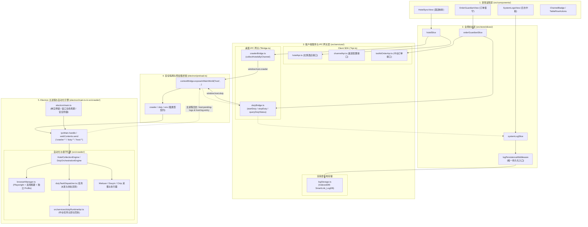

# 全栈统一采集与值守架构设计规范 (Unified Crawler & Duty Architecture)

> 文档状态：已确立并全面实施于 Electron-Only 架构基线
> 适用范围：所有涉及外部 OTA 渠道自动化（门店采集、商品采集、订单值守、会话维持）与文旅中台通信的模块

---

## 1. 架构定位与设计哲学

本系统定位为**纯正的跨平台桌面端控制台应用 (Electron-Only)**，全面废除任何形式的独立 Web 宿主与双模（Electron/Web）降级分支。
系统以“**职责严格隔离、直接优于抽象、零技术暴露**”为核心原则，确立了五层同心圆原生桌面架构：

---

## 2. 端层职责与文件命名刚性契约

为杜绝跨目录同名冲突与职责混淆，各分层命名后缀具有严格的语义约束：

| 分层定位 | 目录路径 | 命名规范 | 职责边界 | 规范示例 |
| :--- | :--- | :--- | :--- | :--- |
| **客户端 SDK** | `src/services/` | `*Api.ts` | 承载渲染层向外部文旅中台网络的异步请求，返回 Promise 数据。 | `hotelApi.ts`, `channelApi.ts`, `toolkitOrderApi.ts` |
| **桌面 IPC 网关** | `src/services/` | `*Bridge.ts` | 封装 `window.host`，提供强类型 IPC 调用，Electron 环境缺失时立即 Fail-Fast 阻断。 | `crawlerBridge.ts`, `dutyBridge.ts` |
| **预加载脚本** | `electron/` | `preload.ts` | 通过 `contextBridge.exposeInMainWorld('host', ...)` 安全注入白名单 API，杜绝 Node 原生对象泄露。 | `preload.ts` |
| **主进程宿主** | `electron/` | `main.ts` | 负责应用单实例锁、生命周期调度、窗口安全策略与原生 IPC 监听器注册。 | `main.ts` |
| **自动化引擎与采集器** | `src/crawler/` | `*Engine.ts`, `*Collector.ts`, `*Runner.ts` | 运行于主进程，负责 Playwright 驱动、会话维持、任务认领与执行回执。 | `engine.ts`, `dutyOrchestrationEngine.ts`, `channels/meituan/meituanDutyRunner.ts` |
| **持久化与日志中间件** | `src/store/`, `src/services/` | `*Middleware.ts`, `*Storage.ts` | 统一管理 Redux 日志流与 IndexedDB (`SmartLink_LogDB`) 唯一持久化落库。 | `logPersistenceMiddleware.ts`, `logStorage.ts` |

---

## 3. 核心设计规范与机制

### 3.1 渠道身份标识全链路大写归一化 (`channelCode`)
- 全链路（UI、Store、Bridge、IPC、Runner、Collector）统一以**大写 `channelCode`** 作为唯一法定凭证：
  - 美团酒店：`MEITUAN`
  - 美团商旅：`MEITUANBIZ`
  - 抖音生活服务：`DOUYIN`
  - 携程：`CTRIP`
  - 飞猪：`FLIGGY`
  - 同程：`TONGCHENG`
  - 去哪儿：`QUNAR`
  - 小红书：`RED`
- 元数据统一由 `src/utils/channelMeta.ts` 集中管理，严禁在业务组件中分散硬编码。

### 3.2 唯一日志数据源流水线 (Single Source of Truth for Logs)
1. **单一数据源边界**：Electron 渲染进程的 IndexedDB（库名 `SmartLink_LogDB`）是全系统**唯一**的日志持久化存储。
2. **主进程日志回流机制**：
   - 主进程生命周期与调度异常通过 `publishMainLog` 暂存至环形缓冲区（上限 50 条）；
   - 渲染层挂载时通过 `logBridge.takePendingHostLogs()` 一次性取回冷启动日志；
   - 运行期间通过 IPC 事件 `'host:log-entry'` 实时推送至渲染进程；
   - 渲染进程统一 dispatch `addLog` / `addLogs`，经由 `logPersistenceMiddleware` 幂等落库，彻底消除“界面可见重启丢失”与“主进程日志黑洞”。

### 3.3 浏览器会话管理与反爬规避 (`browserManager.ts`)
- **独立持久化 Profile**：按渠道隔离存储在 `~/.../profiles/<channelCode>`，杜绝各 OTA 平台登录态与 Cookie 互串。
- **物理锁清理防护**：启动前与关闭后自动清理 `SingletonLock`、`SingletonSocket` 等锁文件，杜绝崩溃残留引发的 `Profile in use` 异常。
- **反爬规避 (Stealth)**：通过 `injectStealthScripts` 抹除 `navigator.webdriver` 等自动化特征。
- **可视化操作与 HUD**：默认以可视化窗口 (Headed) 启动，并注入大模型操作风格的视觉跟踪与状态 HUD，保障操作透明可控。

### 3.4 桌面端安全纵深防御
1. **沙箱与隔离**：严格开启 `contextIsolation: true`、`sandbox: true`、`nodeIntegration: false`。
2. **内容安全策略 (CSP)**：通过 `index.html` 限制仅允许本地脚本与受信任字体/连接。
3. **导航拦截保护**：主进程监听 `will-navigate`，非白名单或非本地构建主页的跳转一律拦截，防止拖拽文件或恶意重定向导致界面状态丢失。
4. **外链与权限**：新窗口统一由系统默认浏览器打开 (`shell.openExternal`)，静默拒绝所有未授权原生系统权限。

### 3.5 多渠道值守工位协同与基类继承模型 (`BaseChannelDutyRunner`)
针对多 OTA 渠道的差异化值守需求，系统确立了**抽象基类下沉 + 差异化领域子模块**的扩展架构：

1. **公共基类能力下沉 (`BaseChannelDutyRunner`)**：
   - 统一声明在 [`src/crawler/duty/dutyContracts.ts`](../../src/crawler/duty/dutyContracts.ts)；
   - **会话与目标 URL 管理**：统一维护 `session: BrowserSession | null` 与 `explicitTargetUrl`；
   - **单页面任务互斥锁 (`runWithMutex`)**：通过串行 Promise 链，保证单工位页面上的 Tab 切换、详情抓取、确认号录入等操作互斥执行，彻底消除页面状态并发踩踏；
   - **Fail-Fast 页面探测 (`getActivePage`)**：会话未启动或页面已关闭时立即抛出 `RUNNER_NOT_RUNNING` / `TARGET_PAGE_NOT_READY` 异常，绝不静默重建；
   - **窗口关闭安全监听 (`waitForBrowserClose`)**：带 `isClosed?.()` 短路安全探测，监听目标页面的 `'close'` 事件与所属 Context 的所有页面关闭，在用户手动关闭浏览器时立即重置 `session = null` 并清退资源；
   - **优雅停止 (`stop`)**：安全关闭会话与浏览器进程。
2. **两类渠道实现模式**：
   - **轻量渠道（如 `DouyinDutyRunner`）**：
     - 直接继承 `BaseChannelDutyRunner`；
     - 零重复会话与互斥锁样板代码，仅专注于渠道特有页面导航、列表响应拦截与纯函数解析。
   - **复杂生产渠道（如 `MeituanDutyRunner`）**：
     - 继承 `BaseChannelDutyRunner` 作为对外统一门面（Facade），所有外部调用通过 `runWithMutex` 串行化保护；
     - 内部遵循单一职责原则，委托专业领域子模块协同工作：
       - [`meituanCardLocator.ts`](../../src/crawler/duty/channels/meituan/meituanCardLocator.ts)：Iframe 作用域穿透与多阶梯卡片定位；
       - [`meituanListCollector.ts`](../../src/crawler/duty/channels/meituan/meituanListCollector.ts)：Tab 切换状态机、网络屏障、高精度防抖补偿与在途合并；
       - [`meituanDetailInspector.ts`](../../src/crawler/duty/channels/meituan/meituanDetailInspector.ts)：网络监听预注册、卡片激活防抖、单号严格比对与敏感数据解密；
       - [`meituanActionExecutor.ts`](../../src/crawler/duty/channels/meituan/meituanActionExecutor.ts)：接单弹窗回填、输入读回校验、取消确认与 `dryRun` 演练；
       - [`meituanRiskGuard.ts`](../../src/crawler/duty/channels/meituan/meituanRiskGuard.ts) / [`meituanModalGuard.ts`](../../src/crawler/duty/channels/meituan/meituanModalGuard.ts)：风控探测与通知弹窗自动穿透。

### 3.6 值守任务类型与取消订单闭环

值守任务能力由 `SUPPORTED_DUTY_TASK_TYPES` 单一契约声明：`OTA_COLLECT_ORDER`、`OTA_IMPORT_ORDER`、`OTA_CONFIRM_IMPORT`、`OTA_CONFIRM_CANCEL` 与 `OTA_CANCEL_ORDER`。

取消订单本地闭环如下：

1. `DutyOrchestrationEngine` 执行 `OTA_COLLECT_ORDER` 后，从权威待处理列表发现 `cancelOrder === true` 的订单；
2. 下游统一创建 `OTA_CANCEL_ORDER`，payload 固定使用大写规范化 `channelCode` 与 `reason`，不携带渠道猜测字段；
3. `dutyTaskContext` 对 `OTA_CANCEL_ORDER` 只从 `payload.channelCode` 提取渠道，缺失即 Fail-Fast；
4. `dutyTaskDispatcher` 将 `OTA_CANCEL_ORDER` 与 `OTA_CONFIRM_CANCEL` 一样路由到渠道 runner 的 `confirmCancel` 能力。

### 3.7 美团商旅单浏览器别名路由 (MEITUANBIZ Alias Routing)

美团商旅 (`MEITUANBIZ`) 与美团 (`MEITUAN`) **共用同一个浏览器值守会话**（单浏览器、单 Tab、同一 Profile），通过过滤规则按任务渠道分流订单：

1. **别名注册与派生态模型**：`DutyOrchestrationEngine` 经 `registerRunnerAlias('MEITUANBIZ', meituanRunner)` 将两个渠道码指向同一 `MeituanDutyRunner` 实例。别名渠道是主渠道的**派生值守状态**（无独立启动/停止入口，UI 不渲染独立开关）：
   - `startDuty('MEITUAN')`：商旅分流开启时**联动激活** `MEITUANBIZ` 派生态（单 Runner 单会话仅启动一次）；`startDuty/stopDuty('MEITUANBIZ')` 直接拒绝并指引操作主渠道；
   - `stopDuty('MEITUAN')`：**无条件连带清理**别名派生态（无论分流开关当前取值）并停止共享 Runner；
   - 工位上报 `otaCollectionTargets` 从渠道状态派生（联动激活后含别名渠道），后台据此下发美团 + 商旅双采集任务；
   - 滞留任务按**开关语义**（而非 Runner 存活语义）拒单 `TASK_ROUTE_UNAVAILABLE`；
   - 面板呈现：映射商旅后 MEITUANBIZ 行折叠进美团行（副标题标注"已映射商旅，值守含商旅分流"）。
2. **渠道身份全链路穿参**：采集结果 `otaChannelCode`、下游派发 payload、协议清洗 `channelCode`、`otaChannel` 标记与备注模板路由均以**任务渠道** (`context.channelCode`) 为准而非 Runner 主渠道，商旅单正确落 PMS 渠道映射（`meituanbiz`）。
3. **统一多渠道过滤规则**：随包 `meituanFilterRules.json` 与持久化 `<userDataDir>/filter-rules/meituan.json` 均为**单文件多渠道格式**（顶层 `channels` 映射，键为规范渠道码）；保存为读-改-写（仅替换对应渠道节）。渠道无关的规则契约（类型/守卫/渠道节提取）统一下沉 [`src/crawler/duty/orderFilterContracts.ts`](../../src/crawler/duty/orderFilterContracts.ts) 供未来渠道复用。

### 3.8 商旅分流开关 (按映射存在性决定过滤行为)

商旅/散客分流以**用户是否配置了有效 `MEITUANBIZ` 渠道映射**为唯一事实源：

| 商户配置 | 语义 | 过滤行为 |
| :--- | :--- | :--- |
| 未配置商旅映射 | 不区分商旅/散客，单一渠道提交 | MEITUAN **不做商旅分流过滤**（TMC 订单照常 ALLOW 走散客渠道，杜绝无人承接的丢单） |
| 配置了商旅映射 | 双渠道分 ID 提交 | 双侧互斥分流：MEITUAN 拒 TMC、MEITUANBIZ 拒非 TMC |

实现为**运行时开关**（非改写规则文件——派生状态不持久化，每次从映射重算）：

1. 过滤模块持有开关（默认关闭），配置解析返回时对 MEITUAN 渠道剥离全部 `orderType === 'TMC'` 规则（含运营自定义 TMC 规则）；改签 (`RESCHEDULED`) 安全规则与渠道分流无关，始终保留；MEITUANBIZ 渠道不受开关影响；
2. 同步链路：渲染层 `toggleChannelDutyThunk` 启动值守前**强制同步**（`hasMeituanBizMapping(mappings)` → IPC `duty:set-meituan-biz-split-enabled` → 引擎门面 → 过滤模块）；`fetchChannelMappingData` 成功后与 `saveChannelMapping` 成功触发映射重拉时 **best-effort 即时推送**（宿主不支持时静默跳过，启动时的强制同步仍是权威路径）；
3. 采集器在途合并按渠道身份隔离，不同渠道并发采集不互相合并结果。
